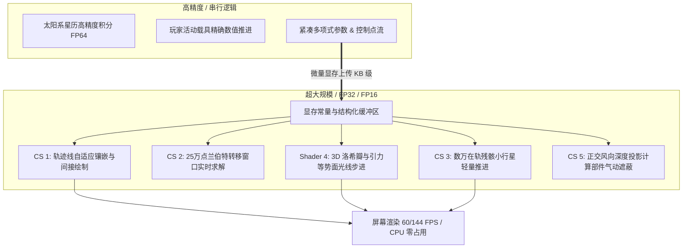
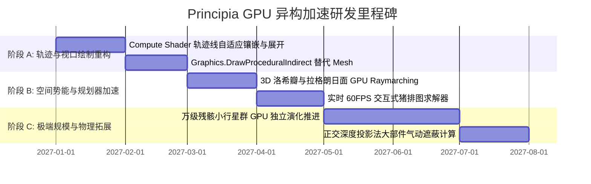
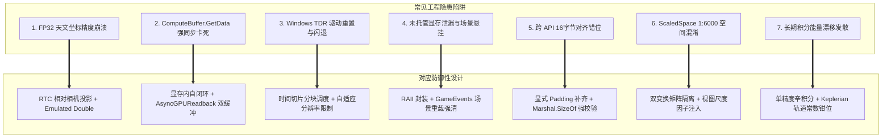

# Principia GPU 大规模低精度计算与异构加速架构设计指南 (GPU Heterogeneous Acceleration Architecture)

## 一、架构愿景与异构分工哲学

Principia 传统上是一个纯 CPU 驱动的科学级轨道物理引擎。由于高精度太阳系天体演化与主航天器轨道严苛依赖 **64位双精度（FP64）甚至扩展精度**，CPU 的辛积分器不可替代。

然而，在游戏主线程与视口交互中，存在大量**“数据密集型、天生易并行、对局部精度不敏感（FP32/FP16 足矣）”**的外围演算。新架构的核心分工准则为：

> **“CPU 负责核心高精度（FP64 强守恒连续积分），GPU 负责大规模低精度与几何呈现（FP32/FP16 高通量湮灭）。”**

通过 Unity **Compute Shader（计算着色器）**、**结构化缓冲区（StructuredBuffer）** 与 **GPU 间接绘制（Indirect Draw）**，将主线程沉重的计算与网格装配任务彻底下放到现代图形硬件。



---

## 二、五大核心 GPU 落地场景与技术实现

### 场景 1：【纯 GPU 驱动的轨迹线自适应镶嵌与间接绘制】

#### 1. 痛点分析
当前 Principia 的 `plotter.cs` 与实验性模组 `PrincipiaSmoothPlotting` 面临的瓶颈：
CPU 每一帧都必须采样数百个离散轨迹点，在托管堆填充 `vertices`、`colors`、`indices` 数组，重新构建 `UnityEngine.Mesh`，再调用 `DrawMesh`。这在地图视图中引入了严重的主线程峰值与顶点上传带宽压力。

#### 2. GPU 架构实现
* **数据流轻量化**：
  CPU 仅向 GPU 传递当前轨迹段的 **Chebyshev 多项式参数或少数关键 Hermite 节点（仅需几 KB 显存传输）**。
* **Compute Shader 屏幕空间细分 (`TrajectoryTessellation.compute`)**：
  在显存内部，Compute Shader 并发计算数千个细分顶点。根据当前相机焦距与曲线曲率实现**屏幕空间自适应 LOD**（拐弯急促处加密点，平直路段稀疏排布）。
* **GPU-Driven 间接绘制**：
  细分点直接写入显存 `AppendStructuredBuffer<float3>`。
  直接调用 Unity 底层 `Graphics.DrawProceduralIndirect`（或 `Graphics.DrawMeshInstancedIndirect`），**完全绕开 Unity 的 `Mesh` 托管对象机制与 CPU-GPU 往返内存搬运**。

```hlsl
// TrajectoryTessellation.compute 片段示例
#pragma kernel CSTessellateTrajectory

StructuredBuffer<ChebyshevChunk> _Chunks;
AppendStructuredBuffer<VertexOutput> _OutputVertices;

[numthreads(64, 1, 1)]
void CSTessellateTrajectory(uint3 id : SV_DispatchThreadID) {
    uint chunk_idx = id.x / SAMPLES_PER_CHUNK;
    float t_norm = (id.x % SAMPLES_PER_CHUNK) / (float)SAMPLES_PER_CHUNK;
    
    // FP32 单精度快速多项式求值 (Clenshaw 算法)
    float3 world_pos = EvaluateChebyshev(chunk_idx, t_norm);
    
    VertexOutput v;
    v.position = world_pos;
    v.color = CalculateFadeColor(t_norm);
    _OutputVertices.Append(v);
}
```

---

### 场景 2：【实时交互式 60 帧星际猪排图与引力弹弓并行搜索】

#### 1. 痛点分析
星际转移窗口计算（Porkchop Plot）需要求解一个二维时间网格：发射时间 $t_0 \times$ 到达时间 $t_f$。
一个高质量 $512 \times 512$ 的热力图需要求解 **262,144 次兰伯特问题（Lambert Problem）**。在 CPU 上单线程或常规线程池计算通常导致游戏界面卡死 2~5 秒，无法实现任何实时交互。

#### 2. GPU 架构实现
* **计算属性匹配**：
  兰伯特方程的通用解法（如 Gooding 算法或 Battin 算法）无复杂分支，由密集的三角函数和开方组成。
  **FP32（单精度浮点）对于寻找转移窗口最小 $\Delta v$ 谷底而言完全够用（精度误差 $< 0.1\text{ m/s}$）**。
* **GPU 2D 并发铺展 (`PorkchopSolver.compute`)**：
  分配二维线程组 `[numthreads(16, 16, 1)]`，整张猪排图的 26 万个状态点在 GPU 上**仅需 $2 \sim 4\text{ ms}$ 即可瞬时解算完毕**。
* **杀手级体验**：
  玩家在地图上拖动飞船机动节点或滑动发射窗口条时，**整张星际转移热力图与等高线曲面以 60 FPS 实时平滑重绘**。

---

### 场景 3：【万级太空残骸、小行星带与卫星星座 GPU 批次推进】

#### 1. 痛点分析
在长期生涯存档或 RSS 真实太阳系中，在轨碎片、失效卫星以及小行星带可膨胀至上千甚至数万颗。CPU 的高精度积分器只能支撑数十艘重点飞船，否则物理步耗时将突破天际。

#### 2. GPU 架构实现
* **轻量级摄动模型**：
  对非活动残骸与小行星，放弃高阶隐式辛积分，改用适合 GPU SIMT 架构的 **4 阶龙格-库塔（RK4）或速度-Verlet 积分器**，叠加中心天体引力与 $J_2 / J_3$ 引力谐波项。
* **显存全生命周期自闭环**：
  所有残骸的六数状态驻留在显存 `RWStructuredBuffer<ParticleState>` 中。
  每一渲染帧调用一次轻量级 Compute Shader 更新状态（50,000 个质点在现代显卡上耗时 $< 0.3\text{ ms}$）。
* **直接实例化绘制**：
  配合 `Graphics.DrawMeshInstancedIndirect`，以近乎 0 CPU 开销在天球上渲染壮观的数万颗粒太空垃圾轨迹与星座群。

---

### 场景 4：【拉格朗日点 3D 洛希瓣与零速度曲面光线步进 (Raymarching)】

#### 1. 痛点分析
Principia 原版支持等势面（Equipotentials）绘制，用于显示拉格朗日点 $L_1 \sim L_5$ 与禁行零速度区。目前采用 CPU 2D 二分扫描线绘制，只能呈现平面的截面切片，无法展示真正的三维引力漏斗。

#### 2. GPU 架构实现
* **引力势场作为隐式曲面（Implicit Surface / SDF）**：
  在旋转参考系中，有效引力标量势具有闭式解析解：
  $$\Phi_{\text{eff}}(\mathbf{r}) = -\sum \frac{G M_i}{\|\mathbf{r} - \mathbf{r}_i\|} - \frac{1}{2} \|\mathbf{\omega} \times \mathbf{r}\|^2$$
* **屏幕空间全动态 Raymarching 着色器**：
  CPU 完全不生成任何 Mesh 几何网格，仅在摄像机前渲染一个全屏后处理面片（Screen Quad）。
  在 Fragment Shader 中以当前像素视线方向进行光线步进，实时求交 $\Phi_{\text{eff}}(\mathbf{r}) = C_{\text{Jacobi}}$。
* **视觉与性能突破**：
  **CPU 耗时完全为 0**，GPU 端直接呈现半透明、自发光、带有折射质感的 3D 洛希瓣重力透镜曲面与拉格朗日鞍点漏斗。

---

### 场景 5：【超大部数载具（500+ Parts）GPU 正交深度气动遮蔽计算】

#### 1. 痛点分析
原版 KSP 与 FAR 在超大火箭（几百上千个部件）穿越稠密大气时帧率暴跌。根源在于 CPU 必须以极为复杂的几何包围盒相交测试去猜测“后面的部件有没有被前面的部件挡住？真实的受风截面积是多少？”。

#### 2. GPU 架构实现
* **正交光栅化等价原理**：
  “某个部件在风向上的暴露截面积”，本质上完全等价于**“从风速逆方向观察，该部件在屏幕上占用的有效像素数量”**！
* **虚拟正交深度管线**：
  1. 沿当前空速矢量逆方向架设一个低分辨率虚拟正交摄像机（$128 \times 128$ 像素缓冲区）。
  2. 将火箭部件渲染至该缓冲区，着色器输出的颜色直接为部件的 `PartID`。
  3. 执行一次高速直方图归约 Compute Shader（Histogram Reduction），单次 Dispatch 瞬间统出每个 `PartID` 的可见像素数。
* **物理突破**：
  受风截面积精度直接达到**像素级物理真实度**，对凹多面体、整流罩内部遮蔽、发动机喷管级联遮蔽天然自适应，**计算时间由 CPU 的 15ms 降至 GPU 的 0.2ms**。

---

## 三、工程技术栈与 Unity 集成接口规范

### 1. 显存资源布局标准
在 C# 适配层中统一定义 GPU 交互资源：
```csharp
public static class PrincipiaGPUContext {
  // 轨迹渲染缓冲区
  public static ComputeShader trajectory_shader;
  public static ComputeBuffer trajectory_chunk_buffer;
  public static ComputeBuffer indirect_draw_args_buffer;
  
  // 猪排图并行求解缓冲区
  public static ComputeShader porkchop_shader;
  public static RenderTexture porkchop_result_texture;
  
  // 状态检查与初始化
  public static bool IsSupported => SystemInfo.supportsComputeShaders;
}
```

### 2. 线程安全性与主线程解耦
* **无阻塞数据流**：所有从 GPU 获取数据的操作（如气动面积统计），严禁调用同步阻塞的 `ComputeBuffer.GetData()`，必须使用 Unity 2019+ 提供的非阻塞异步请求：
  ```csharp
  AsyncGPUReadback.Request(result_buffer, request => {
      if (!request.hasError) {
          // 在下一帧安全消费结果，主线程零停顿
          ApplyAerodynamics(request.GetData<int>());
      }
  });
  ```

---

## 四、演进实施计划与里程碑



1. **里程碑 1（优先级最高）：轨迹线纯 GPU 化**
   - 与本地工作区中的 `PrincipiaSmoothPlotting` 机制融合，彻底干掉主线程动态网格构建。
2. **里程碑 2（高价值交互）：实时猪排图引擎**
   - 打造目前所有 KSP 模组中前所未有的“即拉即显、毫秒级响应”星际转移规划体验。
3. **里程碑 3（视觉科学革命）：3D 洛希瓣与引力等势场**
   - 彻底将 Principia 的天体物理可视化推向专业科学软件级别的表现力。

---

## 五、工程落地避坑指南与防御架构设计 (Engineering Pitfalls & Defensive Guidelines)

在 Unity 2019 / KSP 1.12.x 环境下引入 GPGPU 与 Compute Shader，存在诸多由引擎架构、大尺度天体物理、图形驱动与未托管资源生命周期引发的特有工程陷阱。以下是核心避坑指南与防御性实现规范。



---

### 坑位 1：FloatingOrigin、Krakensbane 与天文尺度下 FP32 精度雪崩

#### 1. 致命诱因
* KSP 坐标空间极其庞大（日心系坐标可达 $10^{11} \sim 10^{12}\text{ m}$，地月系 $10^8 \sim 10^9\text{ m}$）。
* GPU 的 IEEE-754 单精度浮点数（FP32）仅有 **24 位有效尾数（约 7 位有效十进制数）**。
* **精度雪崩现象**：如果将绝对天文坐标以 FP32 直接传递给 Compute Shader 进行几何计算或轨迹展开：
  * 在地月转移轨道（$4 \times 10^8\text{ m}$），FP32 的最小可表示阶梯约为 $\mathbf{32\text{ m}}$；
  * 在木星轨道（$8 \times 10^{11}\text{ m}$），FP32 的阶梯跃变骤增至 $\mathbf{65,536\text{ m}}$！
  * **后果**：轨迹线产生剧烈的阶梯锯齿与断裂，粒子在视口中以几百米为单位抽搐抖动（Precision Jittering）。

#### 2. 防御性设计：相对参考系投影 (Relative-to-Camera, RTC)
* **原则**：绝对天文坐标始终留在 CPU 端的 `double`（FP64）世界中。所有送入 GPU 的顶点坐标，**必须在 CPU 端做完相对于观察点（Camera）的减法运算**，生成微小的相对矢量 $\Delta \mathbf{r} = \mathbf{r}_{\text{world}} - \mathbf{r}_{\text{camera}}$。
* 此时 $\Delta \mathbf{r}$ 的数值范围被压缩在当前视锥体可见范围（$< 10^5\text{ m}$ 甚至更小），转换成 FP32 后的分辨率达到毫米/微米级，完全消除抖动。

```csharp
// 防御模式：CPU 端完成 FP64 相对化减法后再打包
public static Vector3 WorldToRelativeCameraFP32(Vector3d world_pos_fp64, Vector3d camera_pos_fp64) {
    // 强制在 double 精度下做减法
    Vector3d delta = world_pos_fp64 - camera_pos_fp64;
    // 此时 delta 数值极小，降级为 float 不会损失精度
    return new Vector3((float)delta.x, (float)delta.y, (float)delta.z);
}
```

```hlsl
// HLSL 顶点着色器接收纯相对坐标：
float4 camera_relative_pos = float4(_RelativePositions[id], 1.0);
// 仅乘以不带平移分量的观察-投影矩阵 (View-Projection without Camera Translation)
output.positionCS = mul(_NonTranslatingVPMatrix, camera_relative_pos);
```

---

### 坑位 2：`ComputeBuffer.GetData()` 导致主线程渲染管线强同步气泡 (Pipeline Stall)

#### 1. 致命诱因
* 初学者常在 C# 中这样写：
  ```csharp
  compute_shader.Dispatch(kernel, 64, 1, 1);
  compute_buffer.GetData(result_array); // 致命陷阱！
  ```
* `ComputeBuffer.GetData()` 是一个**强制同步阻塞调用**。CPU 发起此调用时，必须暂停当前主线程，等待 GPU 完成当前管线中的所有排队指令并将数据通过 PCIe 总线拷回内存。
* **后果**：直接导致 Unity 主线程出现 **$10 \sim 30\text{ ms}$ 的完全卡死气泡（Stall Bubble）**，游戏瞬间掉帧，性能比纯 CPU 计算还要慢数倍。

#### 2. 防御性设计：显存自闭环与 `AsyncGPUReadback`
1. **数据不出显存准则（VRAM Loopback）**：
   对于轨迹线、残骸粒子、等势面等**只用于渲染呈现**的数据，其结果缓冲区直接作为着色器的输入，配合 `Graphics.DrawProceduralIndirect` 或 `Graphics.DrawMeshInstancedIndirect`，**绝对不读回 CPU 内存**。
2. **必需回读时的非阻塞双缓冲（Async Readback）**：
   对于气动遮蔽统计或碰撞预警等**必须让 C# 消费**的数据，严格使用 Unity 2019 提供的 `AsyncGPUReadback` 异步队列，容忍 $1 \sim 2$ 帧延迟，彻底解耦主线程：

```csharp
// 防御模式：带有飞行状态守卫的异步回读请求
private bool is_readback_in_flight_ = false;

public void RequestAerodynamicDataNonBlocking() {
    if (is_readback_in_flight_) {
        // 前次异步请求尚未返回，跳过当前帧提交，防止 GPU 请求积压
        return;
    }
    
    is_readback_in_flight_ = true;
    AsyncGPUReadback.Request(aero_result_buffer_, OnReadbackCompleted);
}

private void OnReadbackCompleted(AsyncGPUReadbackRequest request) {
    is_readback_in_flight_ = false;
    
    // 硬件移除或切场景容错检查
    if (request.hasError) {
        UnityEngine.Debug.LogWarning("[Principia GPU] Async readback error encountered; fallback to CPU estimation.");
        return;
    }
    
    // 安全在主线程获取数据，零卡顿
    Unity.Collections.NativeArray<int> data = request.GetData<int>();
    ProcessAeroResults(data);
}
```

---

### 坑位 3：Windows TDR 超时与掉驱动闪退 (Timeout Detection & Recovery / CTD)

#### 1. 致命诱因
* Windows 操作系统设有 **TDR（超时检测与恢复）** 机制。如果一个 Compute Shader 的单次 Dispatch 在 GPU 上的运行时间超过驱动上限（注册表 `TdrDelay` 默认通常仅为 **2 秒**），Windows 会认定 GPU 硬件锁死。
* **后果**：操作系统强制重置显示芯片驱动，抛出 `DXGI_ERROR_DEVICE_HUNG` 或 `DEVICE_REMOVED`，KSP 进程直接**闪退桌面（CTD）**，无任何托管堆崩溃日志。
* 在猪排图等大范围网格搜索中，若玩家请求 $1024 \times 1024$ 甚至更高分辨率，低端显卡或核显单次可能耗时超过数百毫秒，导致严重的掉帧突刺甚至触发 TDR。

#### 2. 防御性设计：时间切片分块调度与自适应负载钳位
* **工作负载限制**：根据设备探测（`SystemInfo.graphicsMemorySize` 与硬件型号）对计算网格做上限钳位（如核显上限 $256 \times 256$，独立显卡上限 $512 \times 512$）。
* **时间切片（Time-Slicing）**：将一张大图分割为多个瓦片（Tiles）。每帧仅 Dispatch 1~2 个瓦片，跨越 $3 \sim 4$ 渲染帧完成全图求解。

```csharp
// 防御模式：分帧切片执行器示例
private IEnumerator SolvePorkchopTiled(int total_width, int total_height, int tile_size) {
    int tiles_x = total_width / tile_size;
    int tiles_y = total_height / tile_size;
    
    for (int ty = 0; ty < tiles_y; ty++) {
        for (int tx = 0; tx < tiles_x; tx++) {
            porkchop_shader_.SetInt("_TileOffsetX", tx * tile_size);
            porkchop_shader_.SetInt("_TileOffsetY", ty * tile_size);
            porkchop_shader_.Dispatch(kernel_, tile_size / 16, tile_size / 16, 1);
            
            // 每调度完一个瓦片，出让主线程等待下一帧，确保每帧 GPU 耗时控制在 < 2ms
            yield return null; 
        }
    }
}
```

---

### 坑位 4：ComputeBuffer 原生显存泄漏与 KSP 场景切换野指针

#### 1. 致命诱因
* Unity 的 `ComputeBuffer` 底层封装的是 DirectX/Vulkan/Metal 的 Native GPU 缓冲区指针。
* **C# 托管垃圾回收器（GC）对 Native 显存是盲视的**！将 C# 对象引用设为 `null` **绝不会释放** 底层显存。
* KSP 的游戏场景切换极其频繁（航天中心 $\leftrightarrow$ 飞行视图 $\leftrightarrow$ 追踪站 $\leftrightarrow$ VAB装配大楼）。如果在切换场景时未显式调用 `buffer.Release()`，多次切换后显存持续泄漏，最终触发显存溢出 OOM。
* 若静态单例中保留着已释放或已损坏的 Buffer 句柄，下一场景再次调用 `Dispatch` 会引发底层内存访问越界导致非法崩溃。

#### 2. 防御性设计：严格的 RAII 资源管理与 KSP 场景生命周期监听

```csharp
// 防御模式：安全的 Compute 资源封装器
public sealed class SafeComputeBuffer : IDisposable {
    private ComputeBuffer buffer_;
    public ComputeBuffer Buffer => buffer_;
    public bool IsValid => buffer_ != null && buffer_.IsValid();

    public SafeComputeBuffer(int count, int stride, ComputeBufferType type = ComputeBufferType.Default) {
        buffer_ = new ComputeBuffer(count, stride, type);
    }

    public void Release() {
        if (buffer_ != null) {
            buffer_.Release();
            buffer_ = null;
        }
    }

    public void Dispose() {
        Release();
        GC.SuppressFinalize(this);
    }

    ~SafeComputeBuffer() {
        // 终结器兜底释放，避免彻底泄漏
        Release();
    }
}
```

* **挂载 KSP 场景重载事件**：
  在 `PrincipiaPluginAdapter` 中注册 `GameEvents.onGameSceneLoadRequested`。在场景即将卸载的黄金窗口，强制销毁并清空所有 GPU 资源池，杜绝跨场景野指针。

---

### 坑位 5：跨图形 API（DX11 vs Metal vs Vulkan）16 字节对齐错位

#### 1. 致命诱因
* HLSL 的 `StructuredBuffer<T>` 遵循极其严苛的 **16 字节对齐边界规则（Packing Rules）**。
* 例如以下 C# 与 HLSL 结构体定义：
  ```csharp
  // C# 定义：总大小 12 + 4 = 16 字节
  public struct TrajectoryVertex {
      public Vector3 position; // 12 字节 (float * 3)
      public float alpha;      // 4 字节
  }
  ```
  如果开发者不慎写成：
  ```hlsl
  // HLSL 定义若未严格按照 16 字节对齐：
  struct TrajectoryVertex {
      float3 position; // 12 字节
      float alpha;     // 4 字节
      float velocity;  // 4 字节！跨越了 16 字节边界！
  };
  ```
* 在 DirectX 11、Vulkan 与 macOS Metal 下，驱动编译器对未满 16 字节向量的填充规则不一致，会导致 C# 上传的数据在 GPU 端读取时产生**错位跨界（Field Misalignment）**，读取到的全是 `NaN`、无穷大或畸变几何体。

#### 2. 防御性设计：显式对齐补齐 (Explicit Padding) 与断言检查
* 所有传递给 GPU 的结构体字段，必须显式补齐为 16 字节（4 个 32位字）的整数倍。
* 在 C# 初始化代码中加入编译期/初始化运行时强断言：

```csharp
[StructLayout(LayoutKind.Sequential)]
public struct TrajectoryChunkData {
    public Vector3 start_position; // 12 字节
    public float start_time;       // 4 字节 -> 凑满 16 字节
    
    public Vector3 end_position;   // 12 字节
    public float end_time;         // 4 字节 -> 凑满 16 字节
    
    // 显式校验结构体大小必须为 16 的整倍数
    public static void ValidateAlignment() {
        int size = Marshal.SizeOf<TrajectoryChunkData>();
        if (size % 16 != 0) {
            throw new InvalidProgramException(
                $"[Principia GPU] TrajectoryChunkData size ({size} bytes) is not 16-byte aligned!");
        }
    }
}
```

---

### 坑位 6：KSP 独有的 ScaledSpace (1:6000) 与真实空间坐标系混淆

#### 1. 致命诱因
* KSP 存在两套并行渲染世界：
  1. **Flight World（飞行世界）**：$1:1$ 米制物理空间，活动飞船处于此层，受 `FloatingOrigin` 管理；
  2. **ScaledSpace（缩放空间）**：地图视图（Tracking Station / MapView），尺寸按 **$1:6000$（缩放比 $\sigma = 0.000166667$）** 等比缩小，摄像机为 `ScaledCamera`。
* **混淆陷阱**：Principia 的大部分轨迹预测线是在 MapView 绘制的。如果 Compute Shader 计算出的位置是真实米制坐标，而直接传给 ScaledSpace 的着色器进行渲染，线条将瞬间放大 6000 倍飞出宇宙屏幕外；反之若输入被提前缩放，而光照/着色法线未做等比调整，会导致光照与遮挡彻底崩坏。

#### 2. 防御性设计：坐标空间双模式解耦
* 在向 Shader 提交 Uniform 参数时，显式标明目标视口类型 `TargetViewport`：
  * **Flight 模式**：使用米制相对摄像机投影矩阵 `_FlightMatrix_VP`；
  * **ScaledSpace 模式**：注入缩放因子 `_ScaledFactor = 1.0f / 6000.0f`，并在着色器顶层统一切换变换流程：

```hlsl
// HLSL 统一变换防御处理
float3 world_pos = EvaluateChebyshev(chunk_idx, t_norm);
#if DEFINED_SCALED_SPACE
    float3 render_pos = (world_pos - _ScaledReferenceBodyOrigin) * _ScaledFactor;
#else
    float3 render_pos = world_pos - _CameraWorldPos;
#endif
```

---

### 坑位 7：非辛积分器在超大时间膨胀（Warp 100,000x）下的能量发散

#### 1. 致命诱因
* 在 GPU 上批量演化数万颗残骸与小行星时，通常选用适合 GPU 向量并发的经典 4 阶龙格-库塔（RK4）。
* 然而 **RK4 不是辛积分器（Non-symplectic）**。在玩家开启 KSP 的超大物理/轨道时间加速（$10,000\times \sim 100,000\times$ Warp）时，积分步长 $\Delta t$ 被迫放大。
* **发散现象**：RK4 伴随着固有的微量数值耗散或人造能量输入。在经过数万步迭代后，轨道机械能严重漂移，原本稳定的圆轨道残骸会逐渐“向内螺旋撞向星球”或“无故加速脱离引力井”。

#### 2. 防御性设计：辛式速度-Verlet 与活力公式能量投影钳位
1. **采用单精度辛积分器**：
   在 GPU 端放弃高耗费的显式 Runge-Kutta，改用具备保结构特性的 **Velocity-Verlet（速度-Verlet）** 或 **Symplectic Leapfrog（蛙跳法）**。
2. **能量不变性钳位（Vis-Viva Energy Projection）**：
   残骸所受中心引力满足开普勒活力公式：$v^2 = \mu (\frac{2}{r} - \frac{1}{a})$。
   每隔 $N$ 个时间步，Compute Shader 快速计算当前特定轨道的半长轴 $a$。若发现轨道能量漂移超出阈值，沿当前速度矢量做单步缩放校正，强行约束能量守恒：

```hlsl
// GPU 端微量能量钳位示例
void EnforceEnergyConservation(inout float3 pos, inout float3 vel, float mu, float initial_semi_major_axis) {
    float r = length(pos);
    float target_v_sqr = mu * (2.0 / r - 1.0 / initial_semi_major_axis);
    if (target_v_sqr > 0.0) {
        float current_v_sqr = dot(vel, vel);
        vel *= sqrt(target_v_sqr / current_v_sqr); // 恢复正确机械能
    }
}
```

3. **终极防御：极端 Warp 下切换解析星历**：
   当 `TimeWarp.CurrentRateIndex > 4`（时间膨胀倍率 $> 1000\times$）时，Compute Shader **完全停止数值步进**，切换为解析开普勒根更新模式（Keplerian Ephemeris Propagation），彻底规避任何发散风险。

---

## 六、防御性架构开发上线自检清单 (Pre-flight Checklist)

任何新增的 Principia GPU Compute Shader 模块在合并入主分支前，必须逐一验证以下 10 项工程防御指标：

| 检查项 | 检查内容 | 验收合格标准 |
| :--- | :--- | :--- |
| **1. 兼容性守卫** | `SystemInfo.supportsComputeShaders` 检查 | 不支持的平台自动降级至 CPU 逻辑，无任何报错弹窗 |
| **2. 精度防抖** | 大尺度天文位置传递方式 | 必须经过 CPU 端 double 相对相机投影（RTC），禁止直接传绝对天文坐标 |
| **3. 非阻塞回读** | CPU 回读显存接口审查 | 严禁调用 `ComputeBuffer.GetData()`，必须使用 `AsyncGPUReadback` 或保持显存自闭环 |
| **4. 显存泄漏** | 场景反复切换内存剖析 | 在 Profiler 中连续切换 10 次场景，ComputeBuffer 数量与显存占用净增量必须为 0 |
| **5. 内存对齐** | C# 与 HLSL 结构体字段对齐 | 结构体大小通过 `Marshal.SizeOf` 校验且严格为 16 字节整倍数，包含显式 Padding |
| **6. 超时熔断** | 低端核显与大负载 Dispatch | 单次 Dispatch 在集显（Intel UHD）上耗时 $< 4\text{ ms}$，超大任务具备分块切片（Tile Slicing） |
| **7. 视口空间适配** | ScaledSpace (1:6000) 变换正确性 | 地图视图与飞行视图来回切换无缩放畸变、无网格跳变 |
| **8. 能量稳定性** | 大时间膨胀下的轨道收敛性 | 在 $100,000\times$ Warp 下持续运行 5 分钟，残骸与卫星轨道近拱点漂移率 $< 0.1\%$ |
| **9. 驱动崩溃防护** | `AsyncGPUReadbackRequest.hasError` 检查 | 显卡发生微重置或丢帧时有安全的 fallback，游戏主循环不挂死 |
| **10. 零堆分配** | 每帧 Dispatch 常量上传 | 每帧执行 Compute 调用时，C# 托管堆分配（GC Alloc）严格为 **0 B** |

