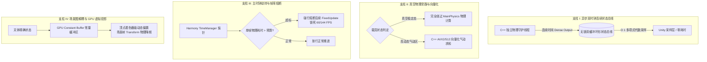
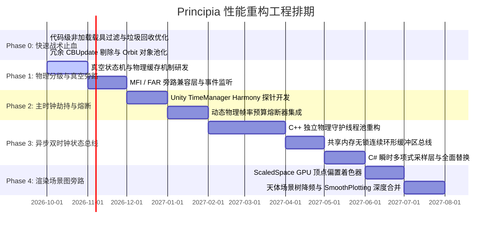

# Principia 新一代高性能架构长期演化规划纲要 (Next-Gen Performance Architecture Roadmap)

## ⚠️ 编号体系说明 (Phase Numbering Map)

本纲要使用 **Roadmap 编号（Phase 0~4）** 描述长期演化的宏观阶段；而 `feature/multi-level-caching-pipeline` 分支的提交信息与 `plan/phase1~6_*.md` 计划书使用另一套**实施编号（Phase 1~6）**描述落地批次。两套编号**不重合、语义不同**，对应关系如下：

| Roadmap 编号（本纲要） | 实施编号（commit / plan/） | 对应提交 |
| :--- | :--- | :--- |
| Phase 0: 快速战术止血 | —（散布于早期 feat/fix 提交） | `a73031434`、`d99b3a5f2`、`392e99dce` 等 |
| Phase 1: 物理分级与真空旁路 | Stage 3 Phase 1（天体/轨迹 GPU 解耦） | `2c6704ad2` |
| Phase 2: 主时钟劫持与帧率熔断 | **实施 Phase 5**（死循环熔断器 + 零分配力缓存） | `ff126fe6d` |
| Phase 3: 异步双时钟状态总线 | **实施 Phase 2**（三缓冲总线 + SPSC 命令队列） **实施 Phase 3**（批量状态同步 + 双时钟桥） | `55223397e`、`3cc9ccf9d` |
| Phase 4: 场景图解耦与 GPU 虚拟投影 | **实施 Phase 4**（场景图解耦 + 虚拟投影） | `31e9a72f0` |
| —（不在本纲要内） | **实施 Phase 6**（GPGPU 并行打靶优化器，属 GPGPU 规格） | `caa3cb2c3` |

> 引用 "Phase N" 时必须注明出处体系（Roadmap 或实施编号），避免歧义。实施进度的唯一事实来源为 `GPGPU_Implementation_TODO.md`。

## 一、愿景与架构核心哲学

### 1. 从“宿主脚本”向“自治伴生引擎”转变
过去 Principia 的设计将自身定位于 Unity 主循环内的一个 `MonoBehaviour` 适配器（Adapter），被动接收 Unity 引擎调度。这导致 Principia 的物理精度与时钟推进完全受制于 Unity 2019 的单线程主循环、固步自封的 `FixedUpdate` 机制与 Mono 虚拟机的 GC 开销。

**新一代架构愿景**：
> **将 Principia 从“附庸于 Unity 的脚本插件”重构为“独立自治的伴生外部物理引擎”。Unity 仅退化为“显示与输入的终端渲染器”，物理时钟与图形渲染实现真正的物理级解耦。**

### 2. 四大核心设计法则
1. **主线程零阻塞准则（Zero Main-Thread Stall）**：主线程在任何情况下不得持有排他写锁，不得同步等待 C++ 计算任务（`future.wait()`），所有状态获取必须是 $O(1)$ 微秒级直接读取。
2. **时钟彻底脱钩准则（Dual-Clock Asynchrony）**：Unity 的渲染帧率和物理步长无论如何震荡、掉帧或波动，严禁拖慢或扭曲 C++ 侧的真实物理积分精度；反之，物理计算也绝不能拖慢图形渲染。
3. **时空分级剪枝准则（Spatiotemporal LOD & Bypass）**：处于外太空真空中无气动、无分级、无剧烈质量变化的载具，严禁重复执行任何逐部件物理预计算。
4. **防御性熔断准则（Frame-Budget Circuit Breaker）**：严格控制单渲染帧内物理步的最大 CPU 耗时，坚决杜绝 Unity“物理死循环（Physics Death Spiral）”导致的帧率腰斩。

---

## 二、四大技术支柱体系 (The Four Architectural Pillars)

### 支柱 I：异步双时钟连续状态总线（Asynchronous Dual-Clock State Bus）
- **C++ 自治物理线程池**：C++ 物理核心拥有独立的高频自旋调度器（例如恒定 100Hz 或根据轨道曲率自适应步长），与 Unity 的帧率完全解绑。
- **稠密输出（Dense Output）与时间多项式总线**：利用高阶积分器原生输出的 Hermite / Chebyshev 多项式切片，持续向一块与 C# 共享的无锁内存区域（Shared Memory / Ring Buffer）写入连续轨迹段。
- **主线程瞬时采样**：Unity 主线程在任何阶段读取位置和姿态时，仅凭时间戳 $t$ 执行一次极快的多项式求值，不调用任何积分方法，不申请任何互斥锁，彻底消灭锁争用。

### 支柱 II：真空物理旁路与向量化（Vacuum Zero-Precalc Bypass & SIMD）
- **真态零预计算旁路（Zero-Precalc Bypass）**：
  外太空载具环境参数（密度、动压、阻力、气动升力）恒为 0。当载具未处于分级、引擎熄火或处于稳定滑行时，彻底阻断 `vessel.precalc.MainPhysics` 的逐部件计算，直接向 KSP 引擎回放静态物理特征缓存。
- **大气层内计算下放（SIMD Aero Downlink）**：
  当飞船穿入大气层时，将部件几何迎角与气动剖面打平为紧凑数组下放至 C++，采用 AVX2 / AVX-512 批量计算受风与热流，绕过 Mono 单线程虚函数开销。

### 支柱 III：主物理时钟劫持与帧率熔断（Physics Loop Hijacking & Circuit Breaker）
- **Unity 物理死循环硬熔断**：通过底层 Harmony 拦截 Unity 的 `TimeManager`，监控单渲染帧中已累积的物理执行时间。一旦达到阈值（如 $8\text{ ms}$），强制截断本渲染帧后续的 `FixedUpdate` 调度，篡改累加器，确保游戏画面永远按显示器刷新率（60/144 FPS）平滑输出。
- **连续时间自适应补偿**：被跳过的物理时间不需要在下一帧通过连续塞入多个 `FixedUpdate` 来恶性追赶，因为 Principia 的连续时间积分器天然支持在任意时间戳直接取样，抹平物理与渲染的时间相位差。

### 支柱 IV：场景图解耦与 GPU 虚拟天体管线（Scene Graph Decoupling & GPU Ephemeris）
- **天体 Transform 场景树降频**：消除每物理帧 50 次对 GameObject 的位移和旋转赋值，将 Unity 场景树中真实天体对象的层级变动降频至 1Hz~2Hz，消除频繁的 PQS 地形四叉树与 Transform 脏标记重算。
- **GPU 着色器顶点偏置（Vertex Shader Offset）**：在 ScaledSpace 缩放空间与地图视角中，将天体的实时轨道参数直接传入 GPU 常量缓冲区，在顶点着色器阶段直接加上动态微位移，在 CPU 场景树保持静止的同时保证视觉上的绝对平滑精确。
- **与 `PrincipiaSmoothPlotting` 联动**：将已有的网格缓存管理器全面整合进渲染流水线，实现绘制线拓扑、天体球与轨道预测线的全流程免重构渲染。

---

## 三、分阶段推进路线图 (Phased Implementation Roadmap)

---

### Phase 0: 快速战术止血 (Immediate Quick-Wins)
*周期：1 ~ 2 周*
*目标：在不改变整体架构的前提下，消除 50%~70% 的低级冗余开销与 GC 顿挫。*
1. **载具过滤（Loaded Vessel Filtering）**：
   在 `Precalc` 与 `ObscenelyEarly` 中严格过滤 `vessel.loaded`，彻底停止对非物理加载的在轨残骸和卫星执行 `MainPhysics` 与 `precalc.enabled` 状态篡改。
2. **天体更新去重与堆内存消除**：
   在 `UpdateBody` 中剥离冗余的第一次 `body.CBUpdate()` 调用；将 `new Orbit(...)` 替换为静态复用的 `scratch_orbit_`。
3. **GUID 序列化缓存**：
   引入 `Dictionary<Guid, string>` 缓存池，前置 `vessel.packed` 判断，消除每秒数千次短字符串堆分配。
4. **游戏环境防护**：
   配置推荐说明，指导用户调大 `Max Physics Delta-Time per Frame`（推荐 `0.08s ~ 0.12s`）。

---

### Phase 1: 物理分级感知与真空零预计算旁路 (Smart Vacuum Bypass)
*周期：第 1 ~ 2 个月*
*目标：消灭外太空大型载具的主线程物理预计算瓶颈。*
1. **真空物理状态机判定器（Vacuum State Machine）**：
   在载具生命周期中监控轨道高度，建立判定模型：
   $$\text{BypassCondition} = (h > h_{\text{atm}}) \land (\Delta m_{\text{fuel}} < \epsilon) \land (\text{No Staging}) \land (\omega < \omega_{\text{max}})$$
2. **主物理预计算拦截网关**：
   对于满足真空稳定态的载具，直接封锁 `vessel.precalc.MainPhysics` 的下发；静态冻结并复用上一帧的 `acceleration_immediate`、`graviticAcceleration` 与质心偏移量。
3. **动态失效监听与即时唤醒（Dirty Invalidation）**：
   深度绑定 KSP 事件系统（`onPartDie`, `onPartCouple`, `onVesselWasModified`, `onStageActivate`），一旦发生质量剧烈变动或形态改变，立即在下一帧唤醒全量预计算重新校准。

---

### Phase 2: Unity 物理循环劫持与帧率熔断 (FixedUpdate Circuit Breaker)
*周期：第 3 ~ 4 个月*
*目标：彻底终结“物理死循环（Physics Death Spiral）”，杜绝掉帧腰斩。*
1. **TimeManager 字节码劫持**：
   利用 Harmony 挂钩 Unity 引擎底层的物理推进主流程。
2. **硬性物理耗时预算（Hard Budget Cap）**：
   设定每个渲染帧的主线程物理耗时上限（默认 $8\text{ ms}$）。
   如果单次 `FixedUpdate` 耗时超标，强行拦截并丢弃后续排队的 `FixedUpdate` 迭代。
3. **时间外推拟合（Extrapolated Phase Blending）**：
   利用 Principia 原生的高精度轨道外推，直接向渲染层补偿被跳过步长的位移，保证视觉上保持满帧流畅度。

---

### Phase 3: 异步双时钟体系与无锁连续状态总线 (Asynchronous Dual-Clock Bus)
*周期：第 5 ~ 7 个月*
*目标：将主线程物理计算开销彻底压降至 0ms。*
1. **C++ 原生物理守护线程重组**：
   改造 `Plugin::AdvanceTime`，将其从主线程同步调用转变为 C++ 后台常驻高频线程（Autonomous Physics Daemon）。
2. **共享无锁双缓冲总线（Lock-Free Ring Buffer）**：
   构建进程内共享内存结构，C++ 积分器以切片形式持续写入稠密多项式数据。
3. **C# 瞬时采样适配层**：
   重构 `ksp_plugin_adapter.cs`。在 `Precalc` 阶段，主线程仅传入当前时间戳 $t$，从内存总线中并发读取插值位置，彻底废除写锁争用和 `FutureWaitForVesselToCatchUp` 阻塞。

---

### Phase 4: 场景图旁路与 GPU 虚拟投影 (GPU Virtual Ephemeris)
*周期：第 8 ~ 9 个月*
*目标：打破 Unity 场景图（Scene Graph）和 Transform 的性能枷锁。*
1. **天体 Transform 降频调度**：
   将天体在 Unity 场景图中的 GameObject 物理更新降频至 1Hz，仅作为粗略参考原点，解除 PQS 地形和层级树的每帧刷新绑定。
2. **GPU 顶点偏移着色器（Vertex Shader Displacement）**：
   针对 ScaledSpace 缩放球和轨道渲染线，编写专用材质着色器，直接在 GPU 端利用常量缓冲区实时计算精细偏置。
3. **整合 `PrincipiaSmoothPlotting`**：
   将本地工作区中已有的网格缓存与动态视网膜细分技术完全合入主干，实现从物理计算到视口网格渲染的全链路无感知零开销。

---

## 四、工程验证与量化考核指标 (KPIs & Benchmarks)

在各阶段推进过程中，必须以严格的量化指标作为验收准绳：

| 评估指标 | 当前现状 (Baseline) | Phase 0 目标 | Phase 1-2 目标 | Phase 3-4 终极目标 |
| :--- | :--- | :--- | :--- | :--- |
| **`Precalc` 单帧主线程耗时** | 10ms ~ 25ms+ (严重阻塞) | $\le 4\text{ ms}$ | $\le 2\text{ ms}$ | **$< 0.2\text{ ms}$ (微秒级)** |
| **物理死锁腰斩率 (Drop to 30 FPS)** | 频繁发生 | 偶发 | **完全杜绝 (0%)** | **完全杜绝 (0%)** |
| **Mono GC 垃圾产生速率** | 每秒数十 KB ~ 数 MB | 降低 80% | 降低 95% | **0 垃圾 (零堆分配)** |
| **大部件空间站 (500+ Parts) 帧率** | 15 ~ 25 FPS | 30 ~ 40 FPS | 50 ~ 60 FPS | **锁定 60/144 FPS** |
| **大星系包 (RSS / 80+ Bodies) 帧率** | 严重掉帧 | 耗时减半 | 平滑运行 | **无感知渲染** |

---

## 五、风险矩阵与防御回退方案 (Risk Management)

1. **浮点原点漂移（Krakensbane / FloatingOrigin）兼容性**：
   - *风险*：在 Phase 3/4 中，绕过场景图或异步采样时，KSP 的反海怪坐标平移可能导致坐标系撕裂。
   - *防御*：在共享内存总线中严格保留漂移位移偏移量（`displacement_offset`），在 C# 采样插值求值时叠加 Krakensbane 帧偏移。
2. **第三方物理 Mod（FAR / Kerbalism / RealismOverhaul）联动冲突**：
   - *风险*：Phase 1 绕过 `MainPhysics` 可能导致 FAR 气动升力或 Kerbalism 辐射采样脱靶。
   - *防御*：建立精准的状态嗅探网关，当检测到载具正处于大气层边缘或发生有效力矩交互时，无缝平滑回退至正常物理管线。
