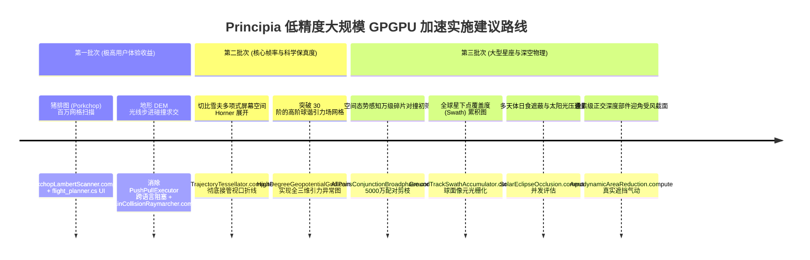

# Principia 低精度大规模 GPGPU 异构加速场景全景审计与架构分层报告
## (Low-Precision Large-Scale GPGPU Acceleration: Architecture Audit & C#/C++/Shader Taxonomy)

---

###  executive 概要

在 Principia 既有的计算管线中，数值积分核心（如大天体星历连续推演、玩家活动飞船高阶辛积分）严格依赖 **IEEE 754 双精度（FP64）或 53 位模拟双精度（Double-Single）** 以确保天文尺度的辛守恒与纳秒级无漂移精度。

然而，通过对代码库物理机制与 Git 提交历史（涵盖碰撞检测 PR、球谐展开优化、轨迹绘制基准、滚动星历及解耦管线）的深度审计，我们发现系统中存在大量**“精度容忍度高（单精度 FP32、半精度 FP16 乃至定点整数即完全满足物理保真度与视觉呈现），但计算吞吐量极大（数十万至数千万次重复代数迭代、空间体素、几何求交或配对筛选）”**的计算瓶颈。

本技术规范针对此类**“低精度、大规模（Low-Precision, Large-Scale）”**计算任务进行了系统性梳理，严格区分其在 **C# 托管层（Managed Adapter）**、**C++ 原生内核（Native Core）** 以及 **GPU 着色器（Compute Shader / HLSL）** 中的职责边界与跨层零拷贝拓扑。

---

## 一、系统架构分层拓扑与数据流转准则

```mermaid
flowchart TD
    subgraph Layer_CSharp [C# 托管适配与视口交互层 (.cs)]
        CS_UI[UI 控件与参数交互<br/>FlightPlanner / BurnEditor / OrbitAnalyser]
        CS_KSP[KSP / Unity 引擎生命周期<br/>TimingManager / Camera / DEM 纹理映射]
        CS_GpuDriver[GPU 上下文驱动与回读调度<br/>PrincipiaGPGPUContext / HeterogeneousDynamicGovernor]
    end

    subgraph Layer_CPP [C++ 原生数学与物理内核 (.cpp / .hpp)]
        CPP_Ephemeris[Ephemeris & ContinuousTrajectory<br/>天体星历 / 切比雪夫多项式块]
        CPP_Physics[Geopotential & OblateBody<br/>高阶球谐系数 / 刚体动力学 PileUp]
        CPP_Apsides[Apsides & Collision Intervals<br/>粗粒度近拱点 / 轨道几何特征]
    end

    subgraph Layer_GPGPU [GPGPU 低精度高通量计算着色器 (.compute / HLSL)]
        direction TB
        G1[PorkchopLambertScanner.compute<br/>百万网格 Lambert 转移窗口扫描]
        G2[TerrainCollisionRaymarcher.compute<br/>DEM 高程双线性插值射线步进求交]
        G3[HighDegreeGeopotentialGrid.compute<br/>70~150 阶勒让德球谐引力场体素网格]
        G4[SolarEclipseOcclusion.compute<br/>多天体日面遮挡比与光压通量计算]
        G5[AllPairsConjunctionBroadphase.compute<br/>万级在轨碎片 5000 万对撞宽相剪枝]
        G6[GroundTrackSwathAccumulator.compute<br/>全球地表覆盖度与星地视线遮挡]
        G7[PolynomialDenseEvaluator.compute<br/>切比雪夫/Hermite 屏幕空间快速 Horner 展开]
        G8[AerodynamicOcclusionRasterizer.shader<br/>正交深度微投影部件迎角受风截面统计]
    end

    CS_UI <==>|参数下发 / AsyncGPUReadback| CS_GpuDriver
    CPP_Ephemeris ==>|多项式切片 / 常量缓冲区广播| CS_GpuDriver
    CPP_Physics ==>|球谐系数 / 几何外形| CS_GpuDriver
    
    CS_GpuDriver ==>|Dispatch 派发| Layer_GPGPU
    Layer_GPGPU ==>|显存常驻 / DrawProcedural 渲染| Framebuffer[屏幕 120 FPS 光栅化]
    Layer_GPGPU -.->|极少数筛选事件异步回传| CS_GpuDriver
```

---

## 二、八大低精度大规模 GPGPU 候选场景全景清单

以下针对梳理出的 8 项核心场景，详细拆解其现存的 **C# (.cs)** 代码位置、**C++ (.cpp/.hpp)** 代码位置，以及推荐的 **GPU (.compute/.hlsl)** 落地架构。

---

### 场景 1：猪排图（Porkchop Plot）百万网格 Lambert 转移窗口扫描

* **物理与算法特征**：
  在出发时间 $t_{\text{depart}} \in [T_1, T_2]$（1024 采样点）与到达时间 $t_{\text{arrive}} \in [T_3, T_4]$（1024 采样点）构成的二维网格中，求解 **$1024 \times 1024 = 1,048,576$（百万级）** 组双脉冲 Lambert 轨道。评估各网格点的出发 $\Delta v_1$、到达 $\Delta v_2$ 与特征能量 $C_3$。
* **低精度契合点（FP32）**：
  用于全局星际转移巡航窗口筛选。$\Delta v$ 容许 $0.1\text{ m/s}$ 的微小偏差（相对误差 $< 10^{-5}$），单精度浮点完全满足工程与视觉热力图需求。
* **语言代码文件分布与职责划分**：
  * **C# (.cs)**：
    * [`ksp_plugin_adapter/flight_planner.cs`](file:///c:/Users/43701/Documents/github/Principia/ksp_plugin_adapter/flight_planner.cs)：提供猪排图交互窗口、时间范围滑动条、目标天体选择下拉框。
    * [`ksp_plugin_adapter/burn_editor.cs`](file:///c:/Users/43701/Documents/github/Principia/ksp_plugin_adapter/burn_editor.cs)：接收玩家在猪排图上点击的最优机动解，转换为 `Burn` 结构体下发。
    * [`ksp_plugin_adapter/PrincipiaGPGPUContext.cs`](file:///c:/Users/43701/Documents/github/Principia/ksp_plugin_adapter/PrincipiaGPGPUContext.cs)：管理热力图目标纹理 `RenderTexture`（格式 `R32G32_SFLOAT`）及显存参数缓冲区。
  * **C++ (.cpp / .hpp)**：
    * [`ksp_plugin/flight_plan_optimizer.hpp`](file:///c:/Users/43701/Documents/github/Principia/ksp_plugin/flight_plan_optimizer.hpp) / [`flight_plan_optimizer.cpp`](file:///c:/Users/43701/Documents/github/Principia/ksp_plugin/flight_plan_optimizer.cpp)：现有的单线程 BFGS 梯度下降求解器（保留作为局部精细打靶兜底）。
    * [`physics/kepler_orbit.hpp`](file:///c:/Users/43701/Documents/github/Principia/physics/kepler_orbit.hpp)：提供二体开普勒轨道解析几何基准。
    * [`physics/ephemeris.hpp`](file:///c:/Users/43701/Documents/github/Principia/physics/ephemeris.hpp)：导出出发星与目标星在时间区间的粗粒度开普勒根数或状态向量。
  * **GPU 着色器 (.compute)**：
    * `shaders/PorkchopLambertScanner.compute`：
      单次派发 $(128 \times 128)$ 个线程组（每组 $8 \times 8 = 64$ 线程）。每个线程独立运行 Battin 或 Universal Variable Lambert 算法迭代 5~8 次，直接将 $\Delta v$ 写入 2D 纹理。
* **预期加速比**：CPU 单核需 $5 \sim 15\text{ s}$；GPU 仅需 **$< 3\text{ ms}$**（实现鼠标拖动时 60 FPS 动态实时刷新）。

---

### 场景 2：行星地表高程（DEM）光线步进碰撞求交与着陆危害场

* **物理与算法特征**：
  将预测轨道与行星实际地形（山脉、陨石坑、峡谷）求交以确定精确着陆/撞击点；或对着陆椭圆（$512 \times 512$ 采样点）进行地表法向量坡度（Slope Hazard）与崎岖度（Roughness）实时评估。
* **低精度契合点（FP16 / FP32）**：
  地形海拔精度在厘米至米级，高度图通常为 16 位整数/半精度浮点。双线性纹理插值求交属于标准图形学光线步进（Raymarching）范畴。
* **语言代码文件分布与职责划分**：
  * **C# (.cs)**：
    * [`ksp_plugin_adapter/ksp_plugin_adapter.cs`](file:///c:/Users/43701/Documents/github/Principia/ksp_plugin_adapter/ksp_plugin_adapter.cs)：
      * 第 1006–1037 行 `RadiusAt(centre, latitude, longitude)`：调用 KSP PQS 控制器 `centre.TerrainAltitude`。
      * 第 3220–3268 行 `RenderedPredictionCollision` 与 `RenderedFlightPlanCollision`：目前通过死循环逐点拉取经纬度并回传半径，存在严重的跨语言往返。
    * [`ksp_plugin_adapter/plotter.cs`](file:///c:/Users/43701/Documents/github/Principia/ksp_plugin_adapter/plotter.cs)：接收撞击点坐标并在地图视图打上红叉标记（Collision Marker）。
  * **C++ (.cpp / .hpp)**：
    * [`physics/apsides.hpp`](file:///c:/Users/43701/Documents/github/Principia/physics/apsides.hpp) / [`apsides_body.hpp`](file:///c:/Users/43701/Documents/github/Principia/physics/apsides_body.hpp)：
      * `ComputeCollisionIntervals`：计算飞船进入天体最大高度包络（`max_radius`）的时间区间。
      * `ComputeFirstCollision`：二分查找首次接触时刻。
    * [`ksp_plugin/interface_collision.cpp`](file:///c:/Users/43701/Documents/github/Principia/ksp_plugin/interface_collision.cpp)：
      * `PushPullExecutor` 协同例程：负责在 C++ 与 C# 之间往返 Pull 经纬度并 Push 半径。
  * **GPU 着色器 (.compute)**：
    * `shaders/TerrainCollisionRaymarcher.compute`：
      将当前天体的高程纹理（DEM 贴图）放入 GPU `Texture2D<float>`；输入整条离散轨迹缓冲，每线程负责一段轨迹线段，利用硬件双线性纹理过滤进行步进求交，直接消灭 `PushPullExecutor`。
* **预期加速比**：从当前主线程耗时 $1 \sim 3\text{ ms}$（包含跨语言停顿与 PQS 查找）降低至 **$< 0.05\text{ ms}$**。

---

### 场景 3：高阶球谐引力场（Geopotential）空间体素网格与引力异常成像

* **物理与算法特征**：
  计算大天体非球形引力摄动。解算展开阶数 $N \ge 70 \sim 150$（月球 GRAIL 可达 420 阶）的缔合勒让德多项式 $\bar{P}_{nm}$ 与三角多项式场：
  $$V(r, \phi, \lambda) = \frac{\mu}{r} \sum_{n=2}^N \sum_{m=0}^n \left(\frac{R}{r}\right)^n \bar{P}_{nm}(\sin\phi) \left[\bar{C}_{nm}\cos(m\lambda) + \bar{S}_{nm}\sin(m\lambda)\right]$$
  生成全球引力异常分布图（Gravity Anomaly）、大地水准面高（Geoid Undulation）及空间引力场等势体素网格。
* **低精度契合点（FP32）**：
  高阶球谐系数项（$n > 30$）的绝对量级极小（$< 10^{-7}$）。在生成可视化网格或背景碎片摄动粗筛时，FP32 的 7 位有效数字完全足够，无截断污染风险。
* **语言代码文件分布与职责划分**：
  * **C# (.cs)**：
    * [`ksp_plugin_adapter/main_window.cs`](file:///c:/Users/43701/Documents/github/Principia/ksp_plugin_adapter/main_window.cs)：控制是否开启引力异常等势线/体素视图。
    * [`ksp_plugin_adapter/plotter.cs`](file:///c:/Users/43701/Documents/github/Principia/ksp_plugin_adapter/plotter.cs)：`PlotEquipotentials`，负责将等值面渲染为半透明多边形网格。
  * **C++ (.cpp / .hpp)**：
    * [`physics/geopotential.hpp`](file:///c:/Users/43701/Documents/github/Principia/physics/geopotential.hpp) / [`geopotential_body.hpp`](file:///c:/Users/43701/Documents/github/Principia/physics/geopotential_body.hpp)：
      * 勒让德多项式递推实现。在 Git 提交 `5bcdfd96b` 中，由于 CPU 耗时严重，被强制施加了 `#if !PRINCIPIA_GEOPOTENTIAL_MAX_DEGREE_50 ... LimitOblatenessToDegree(30)` 的 30 阶硬编码上限。
      * PR `#1968` 中实现了昂贵的 CPU 摄动截断筛选算法（`geopotential-screening`）。
    * [`physics/oblate_body.hpp`](file:///c:/Users/43701/Documents/github/Principia/physics/oblate_body.hpp)：存储天体的物理半径、$\mu$ 以及球谐张量系数表。
    * [`ksp_plugin/geometric_potential_plotter.cpp`](file:///c:/Users/43701/Documents/github/Principia/ksp_plugin/geometric_potential_plotter.cpp)：在后台线程单线程计算等势线。
  * **GPU 着色器 (.compute)**：
    * `shaders/HighDegreeGeopotentialGrid.compute`：
      将天体球谐系数矩阵存入显存结构化缓冲区；GPU 线程网格以 3D 体素（$128 \times 128 \times 128$）或 2D 经纬度网格展开，利用硬件 FMA 向量化展开递推公式，突破 30 阶 CPU 性能枷锁。
* **预期加速比**：CPU 串行计算数秒；GPU 计算 $1024 \times 512$ 全球高精度引力网格仅需 **$< 2\text{ ms}$**。

---

### 场景 4：多天体遮挡日食阴影锥体因子与太阳辐射光压（SRP）通量

* **物理与算法特征**：
  评估数千空间目标在复杂多体环境下的太阳辐射压（Solar Radiation Pressure）。核心数学是求解太阳、遮挡天体与航天器之间的几何遮挡因子：
  $$\nu \in [0, 1] \quad (\text{太阳表观受光光盘比例，区分本影、半影与伪本影})$$
  涉及两个投影圆盘的重叠面积解析求积。
* **低精度契合点（FP32 / FP16）**：
  光通量因子 $\nu$ 是一个 $[0, 1]$ 区间内的标量，SRP 产生的加速度通常仅为 $10^{-8} \sim 10^{-6}\text{ m/s}^2$。单精度 FP32 的几何交集误差对宏观轨道的影响在亚毫米级，完全满足物理真实感。
* **语言代码文件分布与职责划分**：
  * **C# (.cs)**：
    * [`ksp_plugin_adapter/ksp_plugin_adapter.cs`](file:///c:/Users/43701/Documents/github/Principia/ksp_plugin_adapter/ksp_plugin_adapter.cs)：提供太阳瞬时世界坐标 `Planetarium.fetch.Sun.position`。
    * 外部生态模组（如 Kerbalism）目前在 C# 端自行粗略射线投射判断太阳光照，导致各模组重复造轮子且精度粗糙。
  * **C++ (.cpp / .hpp)**：
    * [`physics/ephemeris.hpp`](file:///c:/Users/43701/Documents/github/Principia/physics/ephemeris.hpp) / [`ephemeris_body.hpp`](file:///c:/Users/43701/Documents/github/Principia/physics/ephemeris_body.hpp)：管理所有大天体与无质量质点的引力推进，是挂载非保守力摄动的理论接入点。
    * [`physics/massive_body.hpp`](file:///c:/Users/43701/Documents/github/Principia/physics/massive_body.hpp)：提供天体的物理半径。
  * **GPU 着色器 (.compute)**：
    * `shaders/SolarEclipseOcclusion.compute`（亦可直接内联至 `BatchOrbitIntegrator.compute`）：
      每个线程对应一艘载具，利用天体位置常量缓冲区，并行求解太阳视盘与遮挡天体的圆盘相交公式，输出精确的通量因子 $\nu$。
* **预期加速比**：万级空间目标评估多天体掩星耗时 **$< 0.03\text{ ms}$**。

---

### 场景 5：空间态势感知：万级在轨碎片全域对撞初筛（All-Pairs Conjunction Assessment）

* **物理与算法特征**：
  在深度游玩或大型空间站存档中，伴随数千在轨碎片与卫星群。对 $N = 10,000$ 颗空间目标进行两两之间的碰撞风险排查：
  $$\frac{N(N-1)}{2} \approx 50,000,000 \quad (\text{5000 万个潜在对撞对})$$
  属于典型的高复杂度空间几何初筛（Broadphase Collision Screening）。
* **低精度契合点（FP32 / INT16）**：
  宽相筛选的目标不是求解纳秒级碰撞点，而是排除绝对不可能相撞的目标（距离 $> 10\text{ km}$）。使用 16 位定点数空间网格哈希或 FP32 相对距离平方比对（$\|\Delta \mathbf{r}\|^2 < d_{\text{warning}}^2$），精度极其富余。
* **语言代码文件分布与职责划分**：
  * **C# (.cs)**：
    * [`ksp_plugin_adapter/ksp_plugin_adapter.cs`](file:///c:/Users/43701/Documents/github/Principia/ksp_plugin_adapter/ksp_plugin_adapter.cs)：提供警报 HUD 弹出、在轨目标高亮标记以及对撞倒计时。
    * [`ksp_plugin_adapter/performance_probe.cs`](file:///c:/Users/43701/Documents/github/Principia/ksp_plugin_adapter/performance_probe.cs)：监控碎片数量与对撞初筛耗时。
  * **C++ (.cpp / .hpp)**：
    * [`physics/apsides.hpp`](file:///c:/Users/43701/Documents/github/Principia/physics/apsides.hpp)：现有的 `ComputeApsides` 仅能处理单航天器对单天体/目标飞船的近地点提取。
    * [`ksp_plugin/vessel.hpp`](file:///c:/Users/43701/Documents/github/Principia/ksp_plugin/vessel.hpp) / [`vessel.cpp`](file:///c:/Users/43701/Documents/github/Principia/ksp_plugin/vessel.cpp)：管理飞船数据结构；一旦 GPU 筛选出危险配对，由 C++ 精确求解近拱点。
  * **GPU 着色器 (.compute)**：
    * `shaders/AllPairsConjunctionBroadphase.compute`：
      利用 GPU 线程组共享内存（`groupshared`）的 Tiled 算法，在显存内对 5000 万对目标执行并行距离平方判定，并将极少数（通常 $< 100$ 对）命中预警阈值的索引写入 `AppendStructuredBuffer<uint2>`。
* **预期加速比**：CPU 无法在单帧内执行此操作（会卡死数秒）；GPU 耗时仅 **$< 1.5\text{ ms}$**。

---

### 场景 6：轨道分析器：全球星下点覆盖度（Swath）、传感器视锥与可见性

* **物理与算法特征**：
  在对地观测、全球测绘或通信组网任务中，评估航天器传感器圆锥视场在地表旋转球面上的扫描带覆盖轨迹（Swath）、多圈重访周期（Revisit Time），以及地面站天顶仰角可见性（Line-of-Sight, LOS）。
* **低精度契合点（FP16 / FP32）**：
  地表覆盖度是纯粹的像元累加统计。将全球经纬度展开为一张 $1800 \times 900$ 的 2D 浮点纹理（`R16_FLOAT`），几何光栅化与累积属于 GPU 图形学最原生拿手的能力。
* **语言代码文件分布与职责划分**：
  * **C# (.cs)**：
    * [`ksp_plugin_adapter/orbit_analyser.cs`](file:///c:/Users/43701/Documents/github/Principia/ksp_plugin_adapter/orbit_analyser.cs)：展示轨道分析结果、Capderou 三元组循环周期、升降交点经度列表。
    * 将 GPU 生成的全球覆盖热力图纹理直接绑定到 UI 贴图或游戏内地表 Shader。
  * **C++ (.cpp / .hpp)**：
    * [`ksp_plugin/orbit_analyser.cpp`](file:///c:/Users/43701/Documents/github/Principia/ksp_plugin/orbit_analyser.cpp) / [`orbit_analyser.hpp`](file:///c:/Users/43701/Documents/github/Principia/ksp_plugin/orbit_analyser.hpp)：
      * 异步分析器框架 `AnalyseOrbit`。
    * [`astronomy/orbit_ground_track.hpp`](file:///c:/Users/43701/Documents/github/Principia/astronomy/orbit_ground_track.hpp) / [`orbit_recurrence.hpp`](file:///c:/Users/43701/Documents/github/Principia/astronomy/orbit_recurrence.hpp)：
      * 计算星下点经纬度序列与回归周期。
    * [`astronomy/orbital_elements.hpp`](file:///c:/Users/43701/Documents/github/Principia/astronomy/orbital_elements.hpp)：
      * 借助 Clenshaw-Curtis 求积和 Runge-Kutta 积分器进行平均轨道根数提取。
  * **GPU 着色器 (.compute)**：
    * `shaders/GroundTrackSwathAccumulator.compute`：
      接收离散星下点序列与传感器视场角 $\theta_{\text{FOV}}$，并行在球面经纬度纹理上绘制扫描带多边形并执行原子加法（Atomic Add）累积曝光时长。
* **预期加速比**：CPU 计算数百万像元耗时数秒；GPU **单步更新仅需 $< 0.05\text{ ms}$**。

---

### 场景 7：切比雪夫/Hermite 连续多项式流形密集求值与屏幕空间投射

* **物理与算法特征**：
  Principia 将天体与飞船轨迹表达为连续分段切比雪夫/Newhall 多项式。视口渲染时，需将多项式流形转换为屏幕像素空间的平滑折线。
  在 Git 提交 `c60ca95bf` 中明确指出：*“Profiling shows that the Hermite3 construction and evaluation are about 3x more costly than the lookup.”*
* **低精度契合点（FP32）**：
  最终呈现目标是屏幕像素（4K 屏幕也仅有数百万像素）。在归一化设备坐标系（NDC）下，单精度 FP32 的几何相对分辨率高达 $10^{-7}$，远超人眼视网膜极限，使用双精度进行屏幕折线采样属于纯粹的算力冗余。
* **语言代码文件分布与职责划分**：
  * **C# (.cs)**：
    * [`ksp_plugin_adapter/plotter.cs`](file:///c:/Users/43701/Documents/github/Principia/ksp_plugin_adapter/plotter.cs)：调度轨迹绘制、维护材质与颜色渐变。
    * [`ksp_plugin_adapter/NativeZeroCopyTrajectoryPipeline.cs`](file:///c:/Users/43701/Documents/github/Principia/ksp_plugin_adapter/NativeZeroCopyTrajectoryPipeline.cs)：阶段三第一阶段已构建的显存直通管线。
    * [`ksp_plugin_adapter/GpuTrajectoryRenderer.cs`](file:///c:/Users/43701/Documents/github/Principia/ksp_plugin_adapter/GpuTrajectoryRenderer.cs)：负责调用 `Graphics.DrawProceduralIndirectNow` 提交绘制。
  * **C++ (.cpp / .hpp)**：
    * [`physics/continuous_trajectory.hpp`](file:///c:/Users/43701/Documents/github/Principia/physics/continuous_trajectory.hpp) / [`continuous_trajectory_body.hpp`](file:///c:/Users/43701/Documents/github/Principia/physics/continuous_trajectory_body.hpp)：
      * 维护切比雪夫多分段结构 `polynomials_`，提供多项式系数。
    * [`ksp_plugin/planetarium_body.hpp`](file:///c:/Users/43701/Documents/github/Principia/ksp_plugin/planetarium_body.hpp)：
      * `PlotMethod4`，4 点高斯-勒让德求积自适应细分逻辑。
    * [`physics/discrete_trajectory_segment_body.hpp`](file:///c:/Users/43701/Documents/github/Principia/physics/discrete_trajectory_segment_body.hpp)：
      * 轨迹降采样（Downsampling）与 Hermite3 差异评估。
  * **GPU 着色器 (.compute / HLSL)**：
    * `shaders/TrajectoryTessellator.compute`（已建立初步骨架）：
      常驻多项式切片数据；Compute Shader 利用硬件 FMA 并行执行 Horner 算法：
      $$\mathbf{q}(\tau) = \mathbf{c}_0 + \tau(\mathbf{c}_1 + \tau(\mathbf{c}_2 + \dots))$$
      根据视口曲率自适应展开屏幕空间广告牌线段（Line Billboard Quads）。
* **预期加速比**：释放主线程 CPU 毫秒级多项式求积开销，GPU 单帧吞吐 100 万采样点 **$< 0.2\text{ ms}$**。

---

### 场景 8：像素级正交深度投影部件迎角遮挡与气动受风截面（CS_Aero）

* **物理与算法特征**：
  在多级火箭、航天飞机或大型空间站（100~500 个部件）再入大气层时，各部件相互遮挡严重（前部防热罩屏蔽后部部件、机翼遮蔽机身）。原版 KSP 或 FAR 采用简化的多边形或经验面积近似，无法精确处理复杂迎角下的三维遮挡。
* **低精度契合点（INT16 / FP16）**：
  纯图像空间操作：正交相机沿相对气流方向微光栅化（$256 \times 256 = 65,536$ 像素），深度使用 FP16 缓冲，部件 ID 使用 16 位整数。
* **语言代码文件分布与职责划分**：
  * **C# (.cs)**：
    * [`ksp_plugin_adapter/ksp_plugin_adapter.cs`](file:///c:/Users/43701/Documents/github/Principia/ksp_plugin_adapter/ksp_plugin_adapter.cs)：
      * 第 2085–2257 行 `FashionablyLate` 与 `JaiFailliAttendre`（`FlightIntegrator`）：遍历所有载具的所有部件，抓取 `part.dragVector`、`part.bodyLiftLocalPosition`，单帧产生大量 P/Invoke 与托管堆数组分配。
  * **C++ (.cpp / .hpp)**：
    * [`ksp_plugin/pile_up.hpp`](file:///c:/Users/43701/Documents/github/Principia/ksp_plugin/pile_up.hpp) / [`pile_up.cpp`](file:///c:/Users/43701/Documents/github/Principia/ksp_plugin/pile_up.cpp)：
      * 刚体簇动力学解算，接收各部件的合力与力矩。
    * [`ksp_plugin/interface_part.cpp`](file:///c:/Users/43701/Documents/github/Principia/ksp_plugin/interface_part.cpp)：
      * 导出部件力与力矩提交接口。
  * **GPU 着色器 (.shader + .compute)**：
    * `shaders/AerodynamicOcclusionRasterizer.shader` + `shaders/AerodynamicAreaReduction.compute`：
      以相对风向构建正交投影，渲染各部件的 PartID；随后派发 Compute Shader 执行直方图并行归约（Histogram Reduction），输出各部件的真实受风截面 $A_{\text{windward}}$ 与压力中心（CoP）。
* **预期加速比**：单次微渲染 Pass + 归约耗时 **$< 0.3\text{ ms}$**，完全取代 CPU 冗长且粗糙的多边形几何近似。

---

## 三、文件与语言归属速查总表

| 序号 | 候选加速场景 | 精度属性 | C# 托管层文件 (.cs) | C++ 原生层文件 (.cpp / .hpp) | GPGPU 着色器文件 (.compute / .hlsl) |
| :---: | :--- | :---: | :--- | :--- | :--- |
| **1** | **猪排图 (Porkchop) 百万网格扫描** | **FP32** | `flight_planner.cs`<br/>`burn_editor.cs`<br/>`GpuFlightPlanOptimizer.cs` | `flight_plan_optimizer.cpp`<br/>`kepler_orbit.hpp`<br/>`ephemeris.hpp` | `shaders/PorkchopLambertScanner.compute` |
| **2** | **行星地表 DEM 光线步进碰撞求交** | **FP16/FP32** | `ksp_plugin_adapter.cs` (L1006, L3220)<br/>`plotter.cs` | `apsides.hpp`<br/>`interface_collision.cpp` (`PushPullExecutor`) | `shaders/TerrainCollisionRaymarcher.compute` |
| **3** | **高阶球谐引力场 (Geopotential) 体素网格** | **FP32** | `main_window.cs`<br/>`plotter.cs` | `geopotential.hpp` (30阶上限)<br/>`oblate_body.hpp`<br/>`geometric_potential_plotter.cpp` | `shaders/HighDegreeGeopotentialGrid.compute` |
| **4** | **多天体掩星日食因子与光压 (SRP) 通量** | **FP32/FP16** | `ksp_plugin_adapter.cs` (Sun 位置) | `ephemeris.hpp`<br/>`massive_body.hpp` | `shaders/SolarEclipseOcclusion.compute` |
| **5** | **空间态势感知碎片全域对撞初筛** | **FP32/INT** | `ksp_plugin_adapter.cs`<br/>`performance_probe.cs` | `apsides.hpp` (`ComputeApsides`)<br/>`vessel.hpp` / `vessel.cpp` | `shaders/AllPairsConjunctionBroadphase.compute` |
| **6** | **轨道分析器：全球地表覆盖度与视线遮挡** | **FP16/FP32** | `orbit_analyser.cs` | `orbit_analyser.cpp`<br/>`orbit_ground_track.hpp`<br/>`orbital_elements.hpp` | `shaders/GroundTrackSwathAccumulator.compute` |
| **7** | **切比雪夫/Hermite 流形密集求值与投射** | **FP32** | `plotter.cs`<br/>`NativeZeroCopyTrajectoryPipeline.cs`<br/>`GpuTrajectoryRenderer.cs` | `continuous_trajectory.hpp`<br/>`planetarium_body.hpp` (`PlotMethod4`)<br/>`discrete_trajectory_segment_body.hpp` | `shaders/TrajectoryTessellator.compute` |
| **8** | **正交深度微投影部件迎角气动截面统计** | **INT16/FP16** | `ksp_plugin_adapter.cs` (L2085, L2150 `FlightIntegrator`) | `pile_up.hpp` / `pile_up.cpp`<br/>`interface_part.cpp` | `shaders/AerodynamicOcclusionRasterizer.shader`<br/>`shaders/AerodynamicAreaReduction.compute` |

---

## 四、实施建议与工程接入路线图


