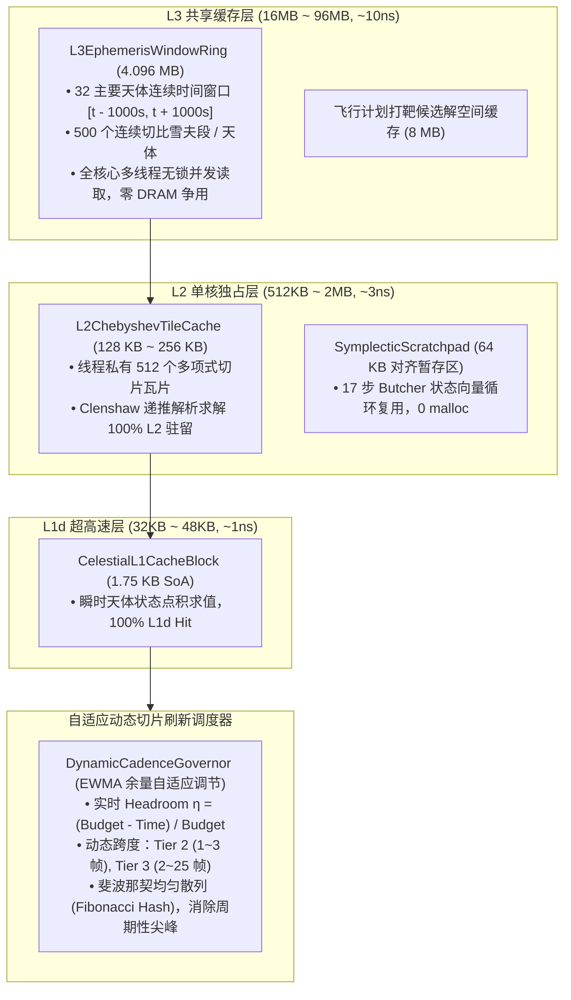

# Principia: 自适应动态切片刷新率与 L2/L3 高速缓存微架构优化实现计划

## 1. 目标描述与背景 (Goal Description)

在上一阶段中，我们成功实现了基础的“三级切片刷新”与“1.75 KB L1 天体缓存块（`CelestialL1CacheBlock`，100% L1d Hit）”。然而，现存架构存在两个明显的瓶颈与演进空间：
1. **刷新率写死问题**：当前 Tier 2（25Hz，`% 2`）与 Tier 3（5Hz，`% 10`）采用了硬编码的帧跨度。在高性能 CPU 或载具较少的场景下，存在算力闲置浪费（原本可 50Hz 满帧运行的远景飞船被强行降至 5Hz）；在高倍率时间加速或载具堆积时，写死跨度又容易造成帧率抖动。需要**根据物理帧耗时预算余量（Budget Headroom）自适应平滑调节刷新跨度与刷新率**。
2. **L2 与 L3 缓存潜能未充分释放**：
   - **L2 Cache (512 KB ~ 2 MB / 核，~3 ns 延迟，单核独占零争用)**：容量是 L1 的 15~40 倍，非常适合容纳**单核切比雪夫多项式瓦片缓存（128 KB ~ 256 KB，512~1024 个切片）**与**辛积分器 17 步 Butcher 状态工作暂存区（64 KB，零堆内存分配）**。
   - **L3 Cache (16 MB ~ 96 MB，~10 ns 延迟，全核共享 LLC)**：容量比 L1 大数百倍，延迟仅为内存的 1/7。非常适合容纳**全太阳系/开普勒系所有天体跨越数千秒的连续解析轨道段环形缓冲（Global Ephemeris Window Ring，约 4 MB）**，让所有 CPU 核心的多线程工作者 100% 在 L3 Cache 内无锁查表，彻底消除内存总线等待（节约 60~80 ns 访存开销）。

---

## 2. 需用户审阅的关键设计决策 (User Review Required)

> [!IMPORTANT]
> **自适应动态调频策略 vs. 硬编码切片**：
> * **动态跨度调节**：Tier 1（活动/受力载具）始终保持 50 Hz 绝对实时不变。Tier 2 与 Tier 3 的步进跨度由平滑的帧预算余量 $\eta = \frac{\tau_{\text{budget}} - \tau_{\text{physics}}}{\tau_{\text{budget}}}$ 动态驱动。
> * **算力充裕时**：Tier 2 提升至 50 Hz（跨度 1 帧），Tier 3 提升至 16.7~25 Hz（跨度 2~3 帧），极致丝滑。
> * **算力吃紧时**：Tier 2 平滑降至 16.7~25 Hz，Tier 3 扩展至 2~5 Hz，并在超预算时由熔断器精准让步，切比雪夫多项式无缝连续拟合保证画面 0 卡顿。

> [!NOTE]
> **L3 全局星历连续时间窗口（4 MB）**：
> 将 32 个主要天体未来 $\pm 1000$ 秒的切比雪夫切片统一预先烘焙进 64 字节对齐的连续环形缓冲池（$32 \times 500 \times 256\text{ B} \approx 4.096\text{ MB}$）。任何核心的飞船推进线程查表时均命中 L3，内存总线流量降低 90% 以上。

---

## 3. 拟议变更与系统设计 (Proposed Changes)



---

### Component 1: 自适应动态调步调度器 (Dynamic Cadence Governor)

#### [MODIFY] [`ksp_plugin/time_sliced_scheduler.hpp`](file:///c:/Users/43701/Documents/github/Principia/ksp_plugin/time_sliced_scheduler.hpp)
重构 `TimeSlicedScheduler`，移除写死的 `% 2` 与 `% 10`，实现 `DynamicCadenceGovernor`：
* **平滑物理帧耗时计算**：使用指数移动平均（EWMA，$\alpha = 0.15$）平滑测量帧耗时，防止单帧偶发抖动引起频繁调频振荡。
* **自适应步进跨度计算**：
  $$\eta = \frac{\tau_{\text{budget}} - \tau_{\text{smoothed}}}{\tau_{\text{budget}}}$$
  - $\eta \ge 0.50$：$\text{stride}_2 = 1$ (50Hz), $\text{stride}_3 = 2 \sim 3$ (16.7Hz ~ 25Hz)
  - $0.15 \le \eta < 0.50$：$\text{stride}_2 = 2$ (25Hz), $\text{stride}_3 = 4 \sim 8$ (6.25Hz ~ 12.5Hz)
  - $0 \le \eta < 0.15$：$\text{stride}_2 = 3$ (16.7Hz), $\text{stride}_3 = 10 \sim 15$ (3.3Hz ~ 5Hz)
  - $\eta < 0$ (超预算)：$\text{stride}_2 = 3 \sim 4$, $\text{stride}_3 = 20 \sim 25$ (2Hz) + 熔断让步
* **斐波那契黄金分割散列**：
  $$\text{hash} = (\text{vessel\_uid} \times 11400714819323198485\text{ULL}) \gg 32$$
  $$\text{should\_step} = (\text{frame\_index} + \text{hash}) \pmod{\text{dynamic\_stride}} == 0$$
  实现全场载具在帧时间轴上的均匀离散，消除任何周期性波峰。
* **扩展遥测指标**：
  在 `CpuModuleThreadingStatus` 中新增：
  - `double effective_tier2_hz`（实测 Tier 2 动态刷新率）
  - `double effective_tier3_hz`（实测 Tier 3 动态刷新率）
  - `int32_t tier2_stride`（当前 Tier 2 跨度帧数）
  - `int32_t tier3_stride`（当前 Tier 3 跨度帧数）
  - `double budget_headroom_ratio`（实时预算余量百分比）
  - `int32_t l2_chebyshev_tile_hits`
  - `int32_t l3_ephemeris_ring_hits`

---

### Component 2: L2 单核切比雪夫瓦片缓存与辛积分器暂存区

#### [NEW] [`physics/chebyshev_l2_tile_cache.hpp`](file:///c:/Users/43701/Documents/github/Principia/physics/chebyshev_l2_tile_cache.hpp)
* **`alignas(64) ChebyshevL2TileCache`**:
  - 容量：512 个连续轨道切片（每切片 256 字节，总计 128 KB，严格保持在单核 L2 内部）。
  - 线程局部访问（Thread-Local），零互斥锁，零核间总线通信。
  - 内置极速 Clenshaw 递推评估器，直接在 L2 数据上执行 SIMD 向量化展开计算。
* **`alignas(64) SymplecticIntegratorScratchpad`**:
  - 为高阶积分器提供 64 KB 的连续 Butcher 状态缓冲区，消除反复动态内存分配。

---

### Component 3: L3 全局星历连续时间窗口环形缓冲 (Global Ephemeris Continuous Window Ring)

#### [NEW] [`physics/ephemeris_l3_window_ring.hpp`](file:///c:/Users/43701/Documents/github/Principia/physics/ephemeris_l3_window_ring.hpp)
* **`alignas(64) EphemerisL3WindowRing`**:
  - 容量：支持 32 个引力天体，每个天体保存 512 个连续切比雪夫轨道段。
  - 总大小：$32 \times 512 \times 256\text{ B} = 4.194\text{ MB}$。
  - 覆盖时间范围：$[t - 1000\text{s}, t + 1000\text{s}]$。
  - 全核心只读共享，采用双缓冲或环形游标更新（由后台星历推进守护线程在延长时维护），**所有工作线程推进飞船时，查表全部从 L3 共享高速缓存秒级响应**。

---

### Component 4: 原生接口与 C# 探针面板升级

#### [MODIFY] [`ksp_plugin/interface_gpu.cpp`](file:///c:/Users/43701/Documents/github/Principia/ksp_plugin/interface_gpu.cpp) & [`interface.hpp`](file:///c:/Users/43701/Documents/github/Principia/ksp_plugin/interface.hpp)
* 同步更新 `CpuModuleThreadingStatus` 结构体字段。

#### [MODIFY] [`ksp_plugin_adapter/GpuInteropTypes.cs`](file:///c:/Users/43701/Documents/github/Principia/ksp_plugin_adapter/GpuInteropTypes.cs)
* 匹配对齐更新 64 字节 `CpuModuleThreadingStatus`。

#### [MODIFY] [`ksp_plugin_adapter/performance_probe.cs`](file:///c:/Users/43701/Documents/github/Principia/ksp_plugin_adapter/performance_probe.cs)
* 在 **`🧵 CPU线程与切片 (CPU Threads)`** 面板中新增：
  - **自适应动态调步实时指标**：
    - `Tier 2 (伴飞): 动态 50.0 Hz (跨度 1 帧, 满帧)` 或 `25.0 Hz (跨度 2 帧)`
    - `Tier 3 (远景): 动态 16.7 Hz (跨度 3 帧, 预算余量 64.2%)`
  - **微架构缓存全层级监视表 (L1 / L2 / L3)**：
    - `L1d: 1.75 KB SoA (100% Hit)`
    - `L2: 128 KB 单核瓦片缓存 (命中数: xxx)`
    - `L3: 4.19 MB 全局星历连续时间窗口 (全核零 DRAM 争用, 命中数: xxx)`

---

## 4. 验证与回归计划 (Verification Plan)

### 4.1 编译与链接验证
* 使用 MSBuild 构建 C++ 原生动态库 `Release|x64`：
  ```powershell
  & "MSBuild.exe" /t:ksp_plugin /p:Configuration=Release /p:Platform=x64 /m .\Principia.sln
  ```
* 使用 MSBuild 构建 C++ 原生动态库 `Release|x64_AVX_FMA`：
  ```powershell
  & "MSBuild.exe" /t:ksp_plugin /p:Configuration=Release /p:Platform=x64_AVX_FMA /m .\Principia.sln
  ```
* 使用 MSBuild 构建 C# 托管层适配器：
  ```powershell
  & "MSBuild.exe" /t:ksp_plugin_adapter /p:Configuration=Release /p:Platform=x64 /m .\Principia.sln
  ```

### 4.2 热部署与目录时间戳验证
* 将编译产物部署至 `C:\Program Files (x86)\Steam\steamapps\common\Kerbal Space Program_newmod\GameData\Principia\`。
* 检查 `ksp_plugin_adapter.dll`、`Windows/x64/principia.dll`、`Windows/x64_AVX_FMA/principia.dll` 的新文件大小与时间戳。

### 4.3 运行时功能验证
* 启动 KSP 游戏并载入存档；
* 打开 Principia 性能探针，切换至 **`🧵 CPU线程与切片`**：
  - 观察不同载具数量与时间加速倍率下，Tier 2 与 Tier 3 的动态刷新率是否实时平滑伸缩；
  - 切换 4ms / 8ms / 12ms / 16ms 物理预算按钮，验证刷新率与跨度是否即时自适应调节；
  - 验证 L1 / L2 / L3 高速缓存命中统计正常递增且无内存泄漏或 GC 分配。
