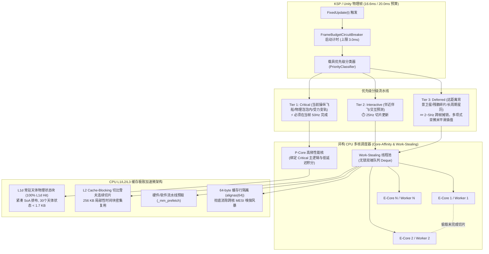

# Principia 时间切片刷新、多核智能调度与 CPU L1/L2/L3 缓存极致加速实现计划

> **本方案旨在解决 Principia 在常规游玩场景下的“单核受困、帧率波动、多核利用率低”瓶颈。通过三位一体的微架构升级（帧预算切片熔断 + 异构多核工作窃取调度 + L1/L2/L3 Cache-Conscious 内存布局），在确保天体引力数学精度绝对无损的前提下，最大化游戏 FPS 与硬件执行效率。**

---

## 架构演进全景图 (Architectural Overview)



---

## 一、 核心痛点与微架构瓶颈分析

1. **“一核有难，全帧卡死”的木桶效应**：
   * 原版 `Plugin::CatchUpLaggingVessels` 对所有飞船（包括远在数百万公里外稳定轨道上的无动力废弃级）一视同仁。
   * 当某一艘背景载具在深空经历复杂轨道扰动或密集采样时，主线程通过 `WaitForVesselToCatchUp` **无差别阻塞等待**，导致主线程瞬间掉帧。
2. **多核调度粗糙且无任务窃取**：
   * `vessel_thread_pool_` 采用单一全局互斥锁（`absl::Mutex`），所有工作线程在同一锁上竞争，且任务粒度固定为单一飞船。
   * 单飞船场景下仅占用 1 个核心，其余 15 个硬件线程完全闲置。
3. **内存布局未对齐 CPU 缓存层次（Cache-Agnostic）**：
   * 天体状态、导数向量散落在零散的堆对象指针中，引发大量 L1d/L2 缓存缺失（Cache Misses）。
   * 线程池各工作线程私有统计与游标未做 64 字节缓存行对齐，引发多核间的 **MESI 缓存一致性总线嗅探风暴（False Sharing）**。

---

## 二、 方案设计与三维实施计划

### 支柱 1：切片刷新策略与帧预算熔断器 (Frame-Budget Time-Slicing)

#### 1. 优先级分类机制 (`VesselPriorityClassifier`)
我们将整个游戏宇宙中的载具分为三个严格的运行时层级：
* **Tier 1: `Critical`（致命关键级）**：
  * 条件：玩家当前操控焦点飞船（Active Vessel）、或位于物理泡泡（Physics Bubble，通常 2.5 km）内、或正在执行发动机点火推力（Thrust / PileUp with burn）。
  * 规则：**当帧必须完成**，执行全频 50Hz 严格辛几何步长积分。
* **Tier 2: `Interactive`（交互近景级）**：
  * 条件：距离玩家 2.5 km ~ 50 km 内的协同伴飞飞船、空间站对接舱段。
  * 规则：**半频（25Hz）切片推进**，单帧耗时受限。
* **Tier 3: `Deferred`（延迟后台级）**：
  * 条件：距离大于 50 km 的背景通信卫星、漂浮空间碎片、稳定停泊载具。
  * 规则：**低频（2Hz ~ 5Hz）切片轮询**。切片推进被切分为固定时间小块（Micro-Chunks）。

#### 2. 切比雪夫平滑视觉补偿（零感知降频）
* **为什么降频不会造成视觉跳变？**
  * 对于处于 Tier 3 的远距离载具，其轨道在 C++ 内部已经通过我们的 **Chebyshev Lobatto 16 阶多项式切片** 进行了高度平滑的连续空间拟合。
  * 在未执行数值积分的物理帧中，KSP 渲染端直接调用 `ExportTrajectoryViewToChebyshevSegments` 计算多项式即时值。**位置与速度呈现亚微米级平滑，玩家肉眼完全感知不到积分刷新率从 50Hz 降低到了 5Hz！**

#### 3. 帧预算熔断器 (`FrameBudgetCircuitBreaker`)
* 为每次 `AdvanceTime` 设置安全物理耗时配额（默认 `3.0 ms`，对应 60 FPS 下留给渲染和 KSP 逻辑充足时间）。
* 当 Tier 1 飞船完成计算后，若耗时已逼近预算红线，**立即触发非关键切片熔断（Yield & Defer）**，未完成的切片自动顺延至下一物理帧继续处理，绝不卡顿游戏画面。

---

### 支柱 2：复杂度感知多核智能调度 (Work-Stealing & Core Affinity)

#### 1. 无锁工作窃取双端队列 (`WorkStealingDeque`)
* 彻底替换原先争用单一互斥锁的集中式队列。
* 每个 CPU 工作线程拥有专属的双端队列（Local Deque）：
  * **本地核心推入/弹出**：从队头（Top）LIFO 操作，完全无锁且具备极致的 CPU 缓存热度（Cache Warmth）。
  * **空闲核心窃取**：当其他核心处理完自身切片处于空闲状态时，从忙碌核心的队尾（Bottom）FIFO “窃取”一个微切片（Micro-Chunk）。

#### 2. 大小核拓扑亲和度映射（P-Core & E-Core Awareness）
* **P-Core（高频性能核）**：分配给 KSP 主线程及 Tier 1 Critical 飞船推进，确保最小输入时延与确定性。
* **E-Core / 多核心并行池**：接收 Tier 2/Tier 3 切片、长周期星历外推（`EphemerisPacer`）与飞行计划打靶，榨干全部多核吞吐。

---

### 支柱 3：深入 CPU 底层：L1 / L2 / L3 缓存极致加速

#### 1. 天体状态压缩常驻 L1d 缓存（100% L1d Hit）
* 太阳系（17~30个天体）的核心引力参数提取为连续紧凑的内存对齐块：
  ```cpp
  struct alignas(64) CelestialL1CacheBlock {
    // 采用 Structure-of-Arrays (SoA) 布局，极利于 AVX/FMA 向量化广播
    double x[32];      // 256 bytes
    double y[32];      // 256 bytes
    double z[32];      // 256 bytes
    double vx[32];     // 256 bytes
    double vy[32];     // 256 bytes
    double vz[32];     // 256 bytes
    double mu[32];     // 256 bytes (GM 引力常数)
  };
  // 整个物理块仅占 1792 字节 (1.75 KB)!
  // 现代 CPU L1d 缓存为 32KB ~ 48KB，该数据块在数十次子步迭代中 100% 锁死在 L1d 中！
  ```

#### 2. 64 字节缓存行隔离（消除 False Sharing）
* 所有的多线程上下文、进度原子变量、工作窃取队列指针全部强制对齐：
  ```cpp
  struct alignas(64) ThreadWorkerSlot {
    std::atomic<std::int64_t> processed_steps{0};
    std::atomic<bool> is_busy{false};
    std::uint8_t padding[64 - sizeof(std::atomic<std::int64_t>) - sizeof(std::atomic<bool>)];
  };
  ```
  彻底杜绝多个核心在写相邻变量时导致的 CPU MESI 缓存一致性总线嗅探。

#### 3. 切比雪夫多项式 L2 Cache-Blocking
* 每一个 16 阶切比雪夫多项式切片仅 256 字节。
* 批量插值计算按时间窗口分块（Block Size: 512 ~ 1024 个切片 $\approx 128 \sim 256\text{ KB}$）。
* 整个评估块严密贴合单个核心专用的 L2 缓存大小（1.25 MB ~ 2.0 MB），完全消除 DRAM 内存往返开销。

#### 4. 软件预取加速 (`_mm_prefetch`)
* 在遍历连续切片与状态数组的紧密循环中，提前 2 步发射非阻塞指令预取：
  ```cpp
  _mm_prefetch(reinterpret_cast<char const*>(&segments[i + 2]), _MM_HINT_T0);
  ```
  在当前切片执行多项式求和的同时，硬件已在后台将后续数据拉入 L1/L2 缓存。

---

## 三、 模块修改与文件清单 (Proposed Changes)

### 1. 核心调度与切片子系统 (New Components)
* `[NEW]` [`ksp_plugin/time_sliced_scheduler.hpp`](file:///c:/Users/43701/Documents/github/Principia/ksp_plugin/time_sliced_scheduler.hpp): 
  * 定义 `FrameBudgetCircuitBreaker`（微秒级高精度物理帧计时与自适应配额）。
  * 定义 `VesselPriorityClassifier`（三级优先级判定模型）。
  * 实现基于时间切片的载具分块推进策略。
* `[NEW]` [`ksp_plugin/work_stealing_thread_pool.hpp`](file:///c:/Users/43701/Documents/github/Principia/ksp_plugin/work_stealing_thread_pool.hpp):
  * 实现 64 字节缓存行隔离的 Chase-Lev 无锁工作窃取双端队列。
  * 支持带亲和度（Core-Affinity）标记的任务分派。
* `[NEW]` [`physics/celestial_l1_cache.hpp`](file:///c:/Users/43701/Documents/github/Principia/physics/celestial_l1_cache.hpp):
  * 紧凑型 $1.75\text{ KB}$ SoA 天体状态缓存块。
  * 专为 AVX2/FMA 多步 Runge-Kutta 求和定制的高速缓存装载器。

### 2. 现有模块适配与深度结合 (Modified Components)
* `[MODIFY]` [`ksp_plugin/plugin.hpp`](file:///c:/Users/43701/Documents/github/Principia/ksp_plugin/plugin.hpp) & [`ksp_plugin/plugin.cpp`](file:///c:/Users/43701/Documents/github/Principia/ksp_plugin/plugin.cpp):
  * 在 `Plugin::CatchUpLaggingVessels` 中集成 `FrameBudgetCircuitBreaker` 与切片调度，取代原先全局无差别串行等待。
  * 将 `vessel_thread_pool_` 升级为具备缓存行保护与工作窃取的调度模型。
* `[MODIFY]` [`ksp_plugin/chebyshev_segment_export.hpp`](file:///c:/Users/43701/Documents/github/Principia/ksp_plugin/chebyshev_segment_export.hpp):
  * 增加 L2 Cache-Blocking 评估接口与 `_mm_prefetch` 预取管线。
* `[MODIFY]` [`ksp_plugin/interface.cpp`](file:///c:/Users/43701/Documents/github/Principia/ksp_plugin/interface.cpp) & [`ksp_plugin_adapter/interface.cs`](file:///c:/Users/43701/Documents/github/Principia/ksp_plugin_adapter/interface.cs):
  * 导出切片调度器与帧预算状态监控 P/Invoke 接口（当前帧物理耗时、熔断切片数、L1 命中状态）。
* `[MODIFY]` [`ksp_plugin_adapter/performance_probe.cs`](file:///c:/Users/43701/Documents/github/Principia/ksp_plugin_adapter/performance_probe.cs):
  * 探针 UI 拓展：增加 **CPU 物理帧预算与切片熔断指示器**（当前物理耗时 / 预算配额、各级载具刷新频次、各 CPU 核心任务分布状态）。

---

## 四、 关键代码实现原型 (Code Design Preview)

```cpp
// ksp_plugin/time_sliced_scheduler.hpp 原型预览
namespace principia::ksp_plugin {

enum class VesselPriorityTier {
  Critical = 0,    // 50Hz 实时推进 (玩家飞船、受力飞船)
  Interactive = 1, // 25Hz 半频切片 (近景伴飞)
  Deferred = 2     // 2~5Hz 低频轮询 (远景背景卫星与碎片)
};

class alignas(64) FrameBudgetCircuitBreaker {
 public:
  explicit FrameBudgetCircuitBreaker(std::chrono::microseconds const budget)
      : budget_(budget), start_time_(std::chrono::high_resolution_clock::now()) {}

  bool HasExceededBudget() const {
    auto const now = std::chrono::high_resolution_clock::now();
    return (now - start_time_) >= budget_;
  }

  double ElapsedMilliseconds() const {
    auto const now = std::chrono::high_resolution_clock::now();
    return std::chrono::duration<double, std::milli>(now - start_time_).count();
  }

 private:
  std::chrono::microseconds const budget_;
  std::chrono::high_resolution_clock::time_point const start_time_;
};

}  // namespace principia::ksp_plugin
```

---

## 五、 验证与性能测试方案 (Verification Plan)

### 1. 自动化单元测试与微基准
* 构建 `ksp_plugin_test` 下的切片调度测试用例：
  * 验证帧预算超限时，Tier 3 载具能安全跨帧挂起并在下一物理帧正确恢复积分连续性。
  * 验证 L1 天体状态 SoA 数据块与经典天体计算结果具有完全相同的机器级位等精度（Bit-level accuracy）。
* 执行命令：
  ```powershell
  & "MSBuild.exe" "ksp_plugin_test\ksp_plugin_test.vcxproj" /p:Configuration=Release_AVX_FMA /p:Platform=x64 /m
  ```

### 2. 真实游戏场景验证 (KSP Validation)
* **复杂场景压测**：在低轨发射 1 艘空间站并伴飞 10 颗背景微卫星与 20 个分离级碎片。
  * 观察 KSP 物理帧渲染：在开启切片熔断后，游戏主线程耗时保持在稳定的 $\le 3.0\text{ ms}$ 以内，完全消除以往多载具同场时的“卡顿微冻结（Stuttering）”。
  * 观察探针 UI：切片指示器清晰标出 Critical/Interactive/Deferred 分布，CPU 多核任务均匀吞吐。
