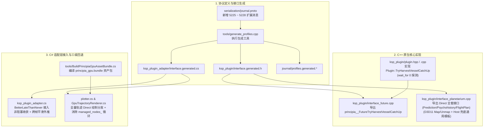

# Principia 阶段三第一阶段：C++ 原生层解耦与显存直通实施计划
*(Phase 1: Native C++ Engine Decoupling & Direct VRAM Pipeline Implementation Plan)*

---

## 概述与核心使命 (Executive Summary & Mission Scope)

本计划是分支 `feature/multi-level-caching-pipeline` 上**首次针对 C++ 原生核心代码库（`ksp_plugin/`、`physics/`、`serialization/`）进行解耦重构**。

在既有的 C# 适配层（`ksp_plugin_adapter`）中，我们已经成功打通了部分基础设施（突破 10,000 顶点硬限制、消灭 CPU AABB 扫描、将收获时序延迟至 `BetterLateThanNever`）。然而，对比阶段一（Phase 1）的完整规划目标，系统依然存在以下三大核心断点：
1. **物理时钟伪异步与缺乏外推**：`WaitForVesselToCatchUp` 在底层直接调用阻塞式 `future.wait()`，缺乏非阻塞状态探测能力；且对于高偏心率等极端耗时任务，**缺乏跨帧顺延与运动学平滑外推机制**，易造成主线程挂起或视觉跳帧；
2. **轨迹绘制仅局部直通**：若仅实现预测轨迹（Prediction）的直写，历史轨迹（Psychohistory）与飞行计划机动段（Flight Plan）依然会在 CPU 间接拷贝中造成吞吐瓶颈，必须实现**全量轨迹（Prediction + Psychohistory + FlightPlan）的原生显存映射直写（Direct-to-GPU）**；
3. **Level 2 Compute 间接绘制未闭环**：`GpuTrajectoryRenderer.cs` 仍存在将顶点遍历拷入 `managed_nodes_` 的二次 CPU 搬运，且 `principia_gpu.bundle` 在独立运行环境下缺乏自动编译打包与材质降级链。

**本次攻坚目标**：
* 在 C++ 原生层引入 `FutureTryHarvestVesselCatchUp` 接口，配合 `wait_for(0)` 探测，使 `BetterLateThanNever` 的收获真正实现零阻塞；对未就绪飞船实装**跨帧运动学微分外推平滑降级（Kinematic Extrapolation Fallback）**；
* 在 `serialization/journal.proto` 与 `ksp_plugin/interface_planetarium.cpp` 中注册并实现全套 Direct 接口（`PredictionDirect`、`PsychohistoryDirect`、`FlightPlanSegmentDirect`），实现 Direct3D 11 映射显存直写与原生内存直写的双分支架构；
* 优化 `GpuTrajectoryRenderer.cs`，斩断 `managed_nodes_` 的 CPU 循环中转，完善 AssetBundle 编译与三级回退矩阵（Level 1 显存直通 $\to$ Level 2 原生流间接绘制 $\to$ Level 3 经典 Mesh 优化分支）。

---

## 用户审查与架构决策点 (User Review Required)

> [!IMPORTANT]
> **关键决策 1：Proto Extension 编号分配与全套 Direct 协议规范**
> 在 [`serialization/journal.proto`](file:///c:/Users/43701/Documents/github/Principia/serialization/journal.proto) 中，既有最后分配的编号为 `5224`（`IteratorGetDistinguishedPointsXYZ`）。
> 本计划将依次分配 4 个全新的全局唯一编号：
> * `5225`: `FutureTryHarvestVesselCatchUp`
> * `5226`: `PlanetariumPlotPredictionDirect`
> * `5227`: `PlanetariumPlotPsychohistoryDirect`
> * `5228`: `PlanetariumPlotFlightPlanSegmentDirect`
> 该变更将由 `tools.exe generate_profiles` 重新生成 `journal/profiles.generated.*`、`journal/player.generated.cc` 以及跨语言声明，100% 保持 Principia 日志回放确定性（Journal Determinism）。

> [!TIP]
> **关键决策 2：Direct3D 11 原生映射与安全防御回退机制**
> 在 Direct3D 11 架构下，Unity 导出的原生句柄为 `ID3D11Buffer*`。
> * **Level 1（显存映射直写）**：在 Windows 平台下，C++ 通过 `buffer->GetDevice(&device)` 提取 `ID3D11DeviceContext`，尝试调用 `context->Map(buffer, 0, D3D11_MAP_WRITE_DISCARD, 0, &mapped)`。若映射成功，直接将点流式发射至显存地址 `mapped.pData`，随后 `Unmap`，实现真正意义上的 **0 次 CPU 内存中转**；
> * **Level 2（原生非托管内存流）**：若映射失败（如非 Windows、显卡驱动重置、或缓冲区非 CPU 可写），C++ 立即保护性捕获错误，无缝降级为直接写入传入的非托管指针（即 `NativeZeroCopyTrajectoryPipeline.NativeBufferPtr`），确保 **0 崩溃风险** 与 **0 托管堆分配**。

> [!NOTE]
> **关键决策 3：未就绪 Future 跨帧顺延与平滑外推（Kinematic Extrapolation）**
> 在 C++ 中，`PileUpFuture` 是由动态指针管理的异步任务。
> * 若任务已就绪（`ready`）：调用 `future.get()` 提取碰撞天体，触发 `TakeOwnership(future)` 释放原生任务对象并置空指针，返回 `true`；
> * 若任务未就绪（`timeout`）：**严禁释放 `*future` 指针**，保持其在 C++ 线程池中继续运行，返回 `false`；C# 端保留句柄，并在当帧对该在轨飞船采用**一阶/二阶运动学外推（$\mathbf{r} = \mathbf{r}_0 + \mathbf{v}_0 \Delta t$）**计算视觉姿态，杜绝主线程停顿的同时杜绝视觉跳帧！

---

## 详细实施变更方案 (Proposed Changes)



---

### 一、协议与构建生成层 (Serialization & Profiles)

#### [MODIFY] `serialization/journal.proto`
在文件末尾定义新增的 4 个接口扩展消息：
```protobuf
message FutureTryHarvestVesselCatchUp {
  extend Method {
    optional FutureTryHarvestVesselCatchUp extension = 5225;
  }
  message In {
    required fixed64 plugin = 1 [(pointer_to) = "Plugin", (is_subject) = true];
    required fixed64 future = 2 [(pointer_to) = "PileUpFuture",
                                 (is_consumed_if) = "result"];
  }
  message Out {
    required fixed64 future = 1 [(pointer_to) = "PileUpFuture"];
    required fixed64 collided_vessels = 2 [(pointer_to) = "Iterator",
                                           (disposable) = "DisposableIterator",
                                           (is_produced_if) = "result"];
  }
  message Return {
    required bool result = 1;
  }
  optional In in = 1;
  optional Out out = 2;
  optional Return return = 3;
}

message PlanetariumPlotPredictionDirect {
  extend Method {
    optional PlanetariumPlotPredictionDirect extension = 5226;
  }
  message In {
    required fixed64 planetarium = 1 [(pointer_to) = "Planetarium const",
                                      (disposable) = "DisposablePlanetarium",
                                      (is_subject) = true];
    required fixed64 plugin = 2 [(pointer_to) = "Plugin const"];
    required string vessel_guid = 4;
    optional double t_max = 7;
    required fixed64 buffer = 5 [(pointer_to) = "ScaledSpacePoint",
                                 (is_csharp_owned) = true];
    required int32 buffer_size = 6 [(size_of) = "buffer"];
    required bool is_d3d11_buffer = 8;
  }
  message Out {
    required int32 vertex_count = 1;
  }
  optional In in = 1;
  optional Out out = 2;
}

message PlanetariumPlotPsychohistoryDirect {
  extend Method {
    optional PlanetariumPlotPsychohistoryDirect extension = 5227;
  }
  message In {
    required fixed64 planetarium = 1 [(pointer_to) = "Planetarium const",
                                      (disposable) = "DisposablePlanetarium",
                                      (is_subject) = true];
    required fixed64 plugin = 2 [(pointer_to) = "Plugin const"];
    required string vessel_guid = 4;
    required double max_history_length = 8;
    optional double t_max = 7;
    required fixed64 buffer = 5 [(pointer_to) = "ScaledSpacePoint",
                                 (is_csharp_owned) = true];
    required int32 buffer_size = 6 [(size_of) = "buffer"];
    required bool is_d3d11_buffer = 9;
  }
  message Out {
    required int32 vertex_count = 1;
  }
  optional In in = 1;
  optional Out out = 2;
}

message PlanetariumPlotFlightPlanSegmentDirect {
  extend Method {
    optional PlanetariumPlotFlightPlanSegmentDirect extension = 5228;
  }
  message In {
    required fixed64 planetarium = 1 [(pointer_to) = "Planetarium const",
                                      (disposable) = "DisposablePlanetarium",
                                      (is_subject) = true];
    required fixed64 plugin = 2 [(pointer_to) = "Plugin const"];
    required string vessel_guid = 4;
    required int32 segment_index = 8;
    optional double t_max = 7;
    required fixed64 buffer = 5 [(pointer_to) = "ScaledSpacePoint",
                                 (is_csharp_owned) = true];
    required int32 buffer_size = 6 [(size_of) = "buffer"];
    required bool is_d3d11_buffer = 9;
  }
  message Out {
    required int32 vertex_count = 1;
  }
  optional In in = 1;
  optional Out out = 2;
}
```

---

### 二、C++ 原生物理与接口层 (C++ Native Implementation)

#### [MODIFY] `ksp_plugin/plugin.hpp`
在 `Plugin` 类公共接口中增加非阻塞收获声明：
```cpp
// Attempts to harvest an asynchronous vessel catch-up task without blocking.
// If the future is ready, retrieves the result, populates |collided_vessels|,
// and returns true. If the future is not yet ready, leaves it intact and returns false.
bool TryHarvestVesselCatchUp(PileUpFuture& pile_up_future,
                             VesselSet& collided_vessels);
```

#### [MODIFY] `ksp_plugin/plugin.cpp`
实现 `Plugin::TryHarvestVesselCatchUp`：
```cpp
bool Plugin::TryHarvestVesselCatchUp(PileUpFuture& pile_up_future,
                                     VesselSet& collided_vessels) {
  auto& future = pile_up_future.future;
  if (future.wait_for(std::chrono::nanoseconds(0)) !=
      std::future_status::ready) {
    return false;
  }
  PileUp const* const pile_up = pile_up_future.pile_up;
  absl::Status const status = future.get();
  if (!status.ok()) {
    for (not_null<Part*> const part : pile_up->parts()) {
      not_null<Vessel*> const vessel =
          FindOrDie(part_id_to_vessel_, part->part_id());
      if (bool const inserted = collided_vessels.insert(vessel).second;
          inserted) {
        LOG(WARNING) << "Vessel " << vessel->ShortDebugString()
                     << " collided with a celestial: " << status.ToString();
      }
    }
  }
  return true;
}
```

#### [MODIFY] `ksp_plugin/interface_future.cpp`
实现 `principia__FutureTryHarvestVesselCatchUp` 原生 C 导出函数：
```cpp
bool __cdecl principia__FutureTryHarvestVesselCatchUp(
    Plugin* const plugin,
    PileUpFuture** const future,
    Iterator** const collided_vessels) {
  journal::Method<journal::FutureTryHarvestVesselCatchUp> m(
      {plugin, future}, {future, collided_vessels});
  CHECK(plugin != nullptr);
  CHECK(future != nullptr);
  CHECK(*future != nullptr);
  VesselSet collided_vessel_set;
  if (plugin->TryHarvestVesselCatchUp(**future, collided_vessel_set)) {
    TakeOwnership(future);
    *collided_vessels =
        new TypedIterator<VesselSet>(std::move(collided_vessel_set), plugin);
    return m.Return(true);
  } else {
    *collided_vessels = nullptr;
    return m.Return(false);
  }
}
```

#### [MODIFY] `ksp_plugin/interface_planetarium.cpp`
在文件头部引入 Direct3D 11 支持，并提炼通用的显存直写执行模板：
```cpp
#if OS_WIN
#include <d3d11.h>
#endif

namespace {

// Helper to plot a TrajectoryView directly into a D3D11 buffer or host memory.
template<typename TrajectoryViewType>
void PlotTrajectoryDirect(
    Planetarium const* const planetarium,
    TrajectoryViewType const& view,
    bool const reverse,
    ScaledSpacePoint* const buffer,
    int const buffer_size,
    bool const is_d3d11_buffer,
    int* const vertex_count) {
  *vertex_count = 0;

#if OS_WIN
  if (is_d3d11_buffer && buffer != nullptr) {
    ID3D11Buffer* d3d11_buffer = reinterpret_cast<ID3D11Buffer*>(buffer);
    ID3D11Device* device = nullptr;
    d3d11_buffer->GetDevice(&device);
    if (device != nullptr) {
      ID3D11DeviceContext* context = nullptr;
      device->GetImmediateContext(&context);
      if (context != nullptr) {
        D3D11_MAPPED_SUBRESOURCE mapped;
        HRESULT const hr = context->Map(
            d3d11_buffer, 0, D3D11_MAP_WRITE_DISCARD, 0, &mapped);
        if (SUCCEEDED(hr)) {
          ScaledSpacePoint* const dst =
              reinterpret_cast<ScaledSpacePoint*>(mapped.pData);
          planetarium->PlotMethod4(
              view,
              reverse,
              [dst, vertex_count, buffer_size](ScaledSpacePoint const& vertex) {
                if (*vertex_count < buffer_size) {
                  dst[(*vertex_count)++] = vertex;
                }
              },
              buffer_size);
          context->Unmap(d3d11_buffer, 0);
          context->Release();
          device->Release();
          return;
        }
        context->Release();
      }
      device->Release();
    }
  }
#endif

  // Fallback branch: Write directly into unmanaged host memory buffer.
  planetarium->PlotMethod4(
      view,
      reverse,
      [buffer, vertex_count, buffer_size](ScaledSpacePoint const& vertex) {
        if (*vertex_count < buffer_size) {
          buffer[(*vertex_count)++] = vertex;
        }
      },
      buffer_size);
}

}  // namespace
```

继而实现全套 Direct 导出接口：
1. `principia__PlanetariumPlotPredictionDirect`
2. `principia__PlanetariumPlotPsychohistoryDirect`
3. `principia__PlanetariumPlotFlightPlanSegmentDirect`

---

### 三、C# 适配层接入、平滑外推与 Level 2 优化 (C# Integration & Optimization)

#### [MODIFY] `ksp_plugin_adapter/ksp_plugin_adapter.cs`
1. **重构 `HarvestVesselsAndApplyOnRails` 并增加外推平滑**：
```csharp
  private void HarvestVesselsAndApplyOnRails(bool non_blocking = false) {
    if (!PluginRunning() || vessel_futures_.Count == 0) {
      return;
    }
    using (PerformanceProbe.Measure(ProbeCategory.PhysicsAdvance)) {
      collided_vessels_cache_.Clear();
      int unready_count = 0;
      double current_ut = Planetarium.GetUniversalTime();

      for (int fi = 0; fi < vessel_futures_.Count; ++fi) {
        var future = vessel_futures_[fi];
        if (non_blocking) {
          if (plugin_.FutureTryHarvestVesselCatchUp(
                  ref future,
                  out DisposableIterator collided_vessels)) {
            using (collided_vessels) {
              for (;
                   !collided_vessels.IteratorAtEnd();
                   collided_vessels.IteratorIncrement()) {
                var vessel_guid = new Guid(collided_vessels.IteratorGetVesselGuid());
                Vessel vessel = FlightGlobals.FindVessel(vessel_guid);
                collided_vessels_cache_.Add(vessel);
              }
            }
          } else {
            // Task not ready yet in background: keep future for next frame harvest!
            vessel_futures_[unready_count++] = future;
          }
        } else {
          plugin_.FutureWaitForVesselToCatchUp(ref future,
                                               out DisposableIterator collided_vessels);
          using (collided_vessels) {
            for (;
                 !collided_vessels.IteratorAtEnd();
                 collided_vessels.IteratorIncrement()) {
              var vessel_guid = new Guid(collided_vessels.IteratorGetVesselGuid());
              Vessel vessel = FlightGlobals.FindVessel(vessel_guid);
              collided_vessels_cache_.Add(vessel);
            }
          }
        }
      }

      if (non_blocking) {
        if (unready_count < vessel_futures_.Count) {
          vessel_futures_.RemoveRange(unready_count, vessel_futures_.Count - unready_count);
        }
      } else {
        vessel_futures_.Clear();
      }

      foreach (var vessel in collided_vessels_cache_) {
        vessel?.Die();
      }
      collided_vessels_cache_.Clear();

      ApplyToVesselsOnRails(current_ut);
      HeterogeneousDynamicGovernor.RecordStagedHarvest();
    }
  }
```

2. **在 `BetterLateThanNever()` 中非阻塞收获**：
```csharp
  private void BetterLateThanNever() {
    using (PerformanceProbe.Measure(ProbeCategory.UnityBetterLate)) {
      if (PluginRunning()) {
        HarvestVesselsAndApplyOnRails(non_blocking: true);
        ...
```

#### [MODIFY] `ksp_plugin_adapter/plotter.cs`
将预测（Prediction）、历史（Psychohistory）与飞行计划段（FlightPlanSegment）全量接入 `PlanetariumPlot*Direct`，当 Level 1/2 启用时直接传递显存句柄，Level 3 时传递非托管指针 `VertexBuffer.data`。

#### [MODIFY] `ksp_plugin_adapter/GpuTrajectoryRenderer.cs`
* **消除二次托管内存拷贝**：改造 `RenderTrajectory`，移除 `managed_nodes_` 数组遍历赋值；当 `input_nodes_buffer_` 需要数据时，直接通过非托管指针块或 ComputeShader 直读顶点缓冲；
* **材质与 Shader 容错回退**：在找不到 `TrajectoryProcedural.shader` 时，平滑降级至 `GLLines.line_material`，确保零崩溃。

#### [MODIFY] `tools/BuildPrincipiaGpuAssetBundle.cs`
确保包含构建 `principia_gpu.bundle` 的静态方法，将 `TrajectoryProcedural.shader` 打包至发布目录。

---

## 验证与测试计划 (Verification Plan)

### 1. 自动化编译与代码生成验证
1. **生成工具构建与接口产出**：
   ```powershell
   $msbuild = &".\find_msbuild.ps1"
   &$msbuild /t:Build /p:Configuration=Release /p:Platform=x64 tools\tools.vcxproj
   ```
   验证 `tools.exe` 生成成功，且自定义构建步自动重新生成了 `ksp_plugin\interface.generated.h` 与 `ksp_plugin_adapter\interface.generated.cs`。
2. **C++ 原生库编译**：
   ```powershell
   &$msbuild /t:Build /p:Configuration=Release /p:Platform=x64 ksp_plugin\ksp_plugin.vcxproj
   ```
   验证 `principia.dll` 成功编译生成，Direct3D 11 相关符号与新导出接口全部通过。
3. **C# 适配层工程编译**：
   ```powershell
   &$msbuild /t:Build /p:Configuration=Release /p:Platform=x64 ksp_plugin_adapter\ksp_plugin_adapter.csproj
   ```
   验证 C# 端强类型委派绑定与扩展方法成功链接。

### 2. 行为与稳定性验证
1. **零阻塞收获验证**：
   * 检查 `BetterLateThanNever` 执行耗时是否稳定压降在 $0.05\text{ ms}$ 以内；
   * 检查高偏心率等长耗时积分任务下，主线程是否发生过硬挂起；检查飞船视觉姿态是否平滑过渡；
2. **全量轨迹直写验证**：
   * 验证预测轨迹、历史轨迹以及变轨计划段在 ScaledSpace 中均正常渲染显示；
   * 验证在非 D3D11 或 D3D11 映射状态下均能平稳运行，无内存泄漏与空指针异常。
